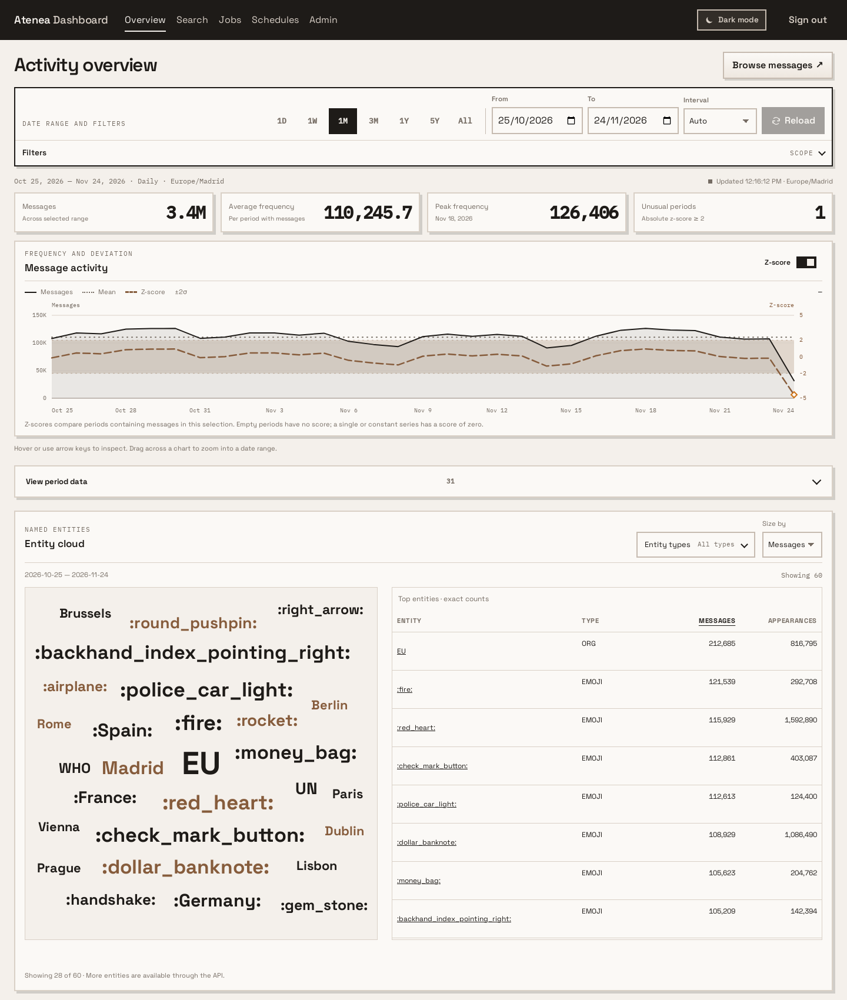
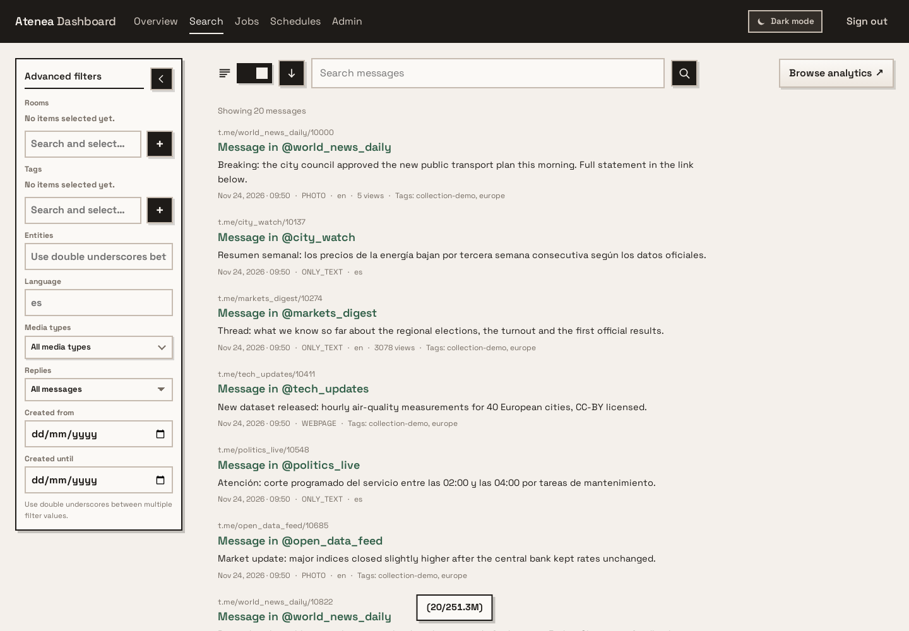
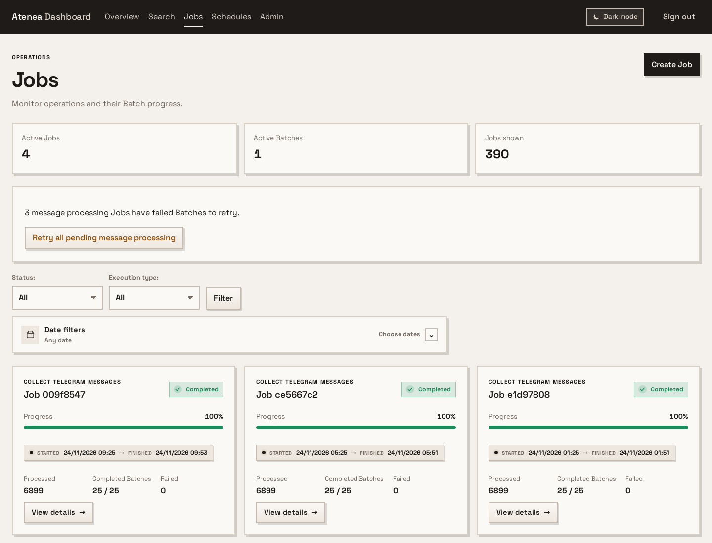
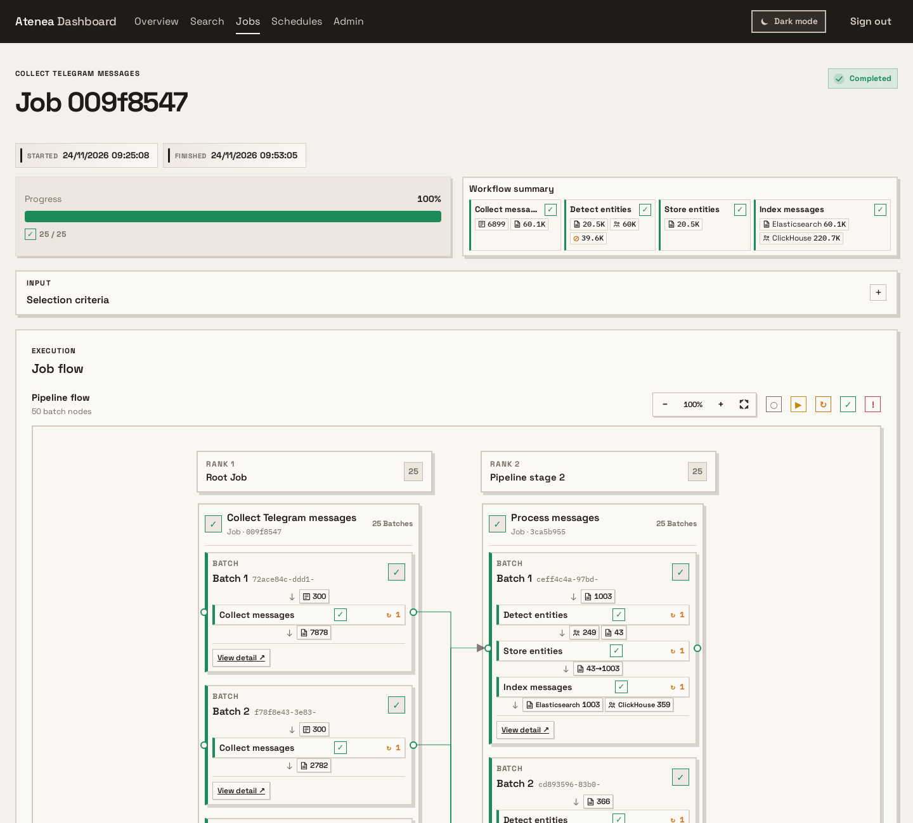
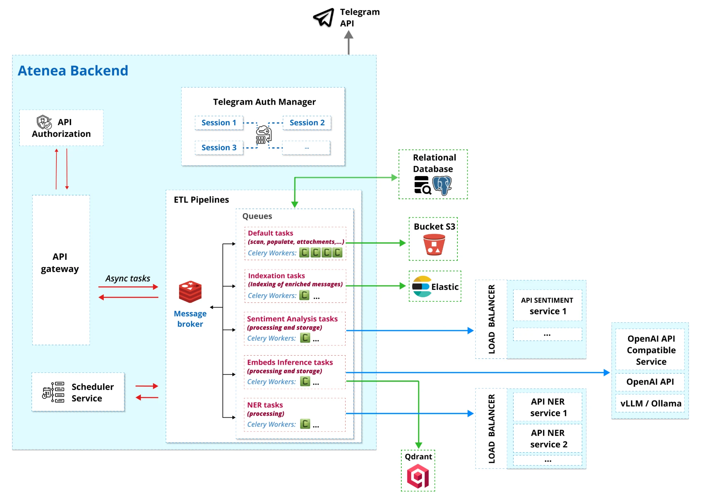

<h1 align="center">Atenea</h1>

<p align="center">
  <strong>An open-source platform for continuous Telegram monitoring, NLP enrichment, and semantic retrieval.</strong>
</p>

<p align="center">
  <a href="https://doi.org/10.1016/j.softx.2026.103067"></a>
  <a href="https://github.com/GICP-Projects/AteneaDev/releases/latest"></a>
  <a href="./LICENSE"></a>
  
  
</p>

<p align="center">
  <a href="#features">Features</a> ·
  <a href="#screenshots">Screenshots</a> ·
  <a href="#architecture">Architecture</a> ·
  <a href="#quick-start">Quick start</a> ·
  <a href="#documentation">Documentation</a> ·
  <a href="#citation">Citation</a>
</p>

<p align="center">
  
</p>

Atenea monitors public Telegram channels and groups continuously and builds
persistent, enriched repositories from them. It combines seed-based channel
discovery, credential-aware data collection, NLP enrichment (named entities,
sentiment, embeddings), attachment preservation, and retrieval through lexical,
semantic and structured queries.

It is designed for research and operational workflows such as longitudinal
analysis, monitoring of entities or topics, anomaly-oriented time-series
exploration, early detection of coordinated campaigns (disinformation, spam),
and reproducible dataset construction.

## Features

- **Continuous collection.** Ingest seed links in bulk, resolve them into
  monitorable rooms, and scan messages and channel comments on a schedule.
- **Credential pool.** Telegram API credentials are load-balanced
  automatically, with `FloodWait` tracking and access recovery for rooms whose
  credential stops working.
- **NLP enrichment.** Named Entity Recognition and sentiment run as scalable
  FastAPI microservices. Embeddings come from any OpenAI-compatible provider
  (OpenAI, vLLM, Ollama).
- **Search.** Lexical and structured search on Elasticsearch, semantic search
  on Qdrant, and cursor-paginated retrieval of stored messages for bulk export.
- **Analytics.** Message activity statistics with z-score anomaly overlays, and
  entity rankings backed by ClickHouse.
- **Attachment preservation.** Catalogue Telegram media metadata or download
  selected files to S3-compatible storage with SHA-256 provenance. Whitelisted
  external download URLs are catalogued as well.
- **Durable processing.** Every pipeline runs as a resumable Job made of leased
  Batches, with retries, recovery, and interval, crontab or one-off schedules.
- **Staff dashboard.** A web UI to explore activity, search messages, launch
  and follow Jobs, and manage schedules, alongside the full REST API (Swagger).
- **Collections through tags.** Seeds carry user-defined tags that propagate to
  rooms and messages, so every step of the workflow can target the same
  reproducible collection.

## Screenshots

<table>
  <tr>
    <td width="50%"></td>
    <td width="50%"></td>
  </tr>
  <tr>
    <td align="center"><em>Lexical and stored-message search</em></td>
    <td align="center"><em>Jobs and their Batch progress</em></td>
  </tr>
  <tr>
    <td colspan="2"></td>
  </tr>
  <tr>
    <td colspan="2" align="center"><em>Pipeline flow of a Job: collection, entity detection and indexing, Batch by Batch</em></td>
  </tr>
</table>

## Architecture

<p align="center">
  
</p>

| Component | Role |
|-----------|------|
| **Django REST API** | Core of the platform: authentication, endpoints, Telegram credential management, the staff dashboard and the scheduler. |
| **Celery + Redis** | Asynchronous ETL pipelines on dedicated queues (scan, index, NER, embeddings, sentiment). Redis is the broker and stores media progress. |
| **PostgreSQL** | Source of truth for seeds, rooms, messages, annotations, Jobs and attachment metadata. |
| **Elasticsearch + Kibana** | Lexical and structured search, activity statistics and optional Kibana dashboards. |
| **Qdrant** | Message embeddings for semantic search and embedding-based categorization. |
| **ClickHouse** | Analytical facts for entity rankings. |
| **S3-compatible storage** | Selectively downloaded Telegram media (MinIO, AWS S3, R2, and others). |
| **NER and sentiment services** | FastAPI microservices that scale independently behind a load balancer. |
| **Embeddings provider** | Any OpenAI-compatible endpoint. |

See the [API README](./src/atenea_api/README.md#architecture-and-design) for the
detailed architecture, the endpoint reference and the end-to-end workflow.

## Repository layout

```text
.
├── .env.example            # Template for every environment variable
├── src/
│   ├── atenea_api/         # Django REST API, Celery pipelines and staff dashboard
│   │   ├── app_*/          # Django apps (telegram, entity, metadata, scheduler, stats, dashboard, ...)
│   │   ├── docs/           # Deployment, configuration, API, pipeline and scheduling guides
│   │   └── es_cluster/     # Elasticsearch + Kibana Docker Compose stack
│   └── atenea_services/    # FastAPI microservices: api_ner and api_sentiment
└── LICENSE
```

## Quick start

Requirements: Docker with Compose, [uv](https://docs.astral.sh/uv/),
Python 3.11, GNU `screen`, and a reachable Elasticsearch 8 cluster (a ready-made
stack is provided in [`src/atenea_api/es_cluster`](./src/atenea_api/es_cluster/README.md)).

1. **Configure the environment.** Fill in the values in `.env.dev` without
   quotes, because Docker reads them verbatim.
   ```bash
   cp .env.example .env.dev
   ```
2. **Install the API dependencies.**
   ```bash
   uv sync --project src/atenea_api
   ```
3. **Start everything.** This launches the infrastructure (PostgreSQL, Redis,
   MinIO, ClickHouse), applies the migrations, and starts the Django server on
   port `28000` and every Celery worker in `screen` sessions.
   ```bash
   src/atenea_api/deploy_dev.sh up
   ```
4. **Create an administrator.**
   ```bash
   cd src/atenea_api
   DJANGO_SETTINGS_MODULE=atenea_api.settings.development uv run python manage.py createsuperuser
   ```
5. **Add a Telegram API credential** in the Django admin at
   <http://localhost:28000/admin/app_telegram/telegramauth/>. Then open the
   dashboard at <http://localhost:28000/dashboard/> or the API documentation at
   <http://localhost:28000/swagger>.

The NER and sentiment services are deployed separately, as described in
[`src/atenea_services`](./src/atenea_services/README.md). For the step-by-step
setup, see the [development deployment guide](./src/atenea_api/docs/dev_deployment.md);
for a server installation, see the [production deployment guide](./src/atenea_api/docs/prod_deployment.md).

## Documentation

| Topic | Guide |
|-------|-------|
| Architecture, endpoints and workflow | [API README](./src/atenea_api/README.md) |
| REST API walkthrough | [REST API usage](./src/atenea_api/docs/api_usage.md) |
| Staff dashboard | [Dashboard guide](./src/atenea_api/docs/dashboard.md) |
| Development deployment | [Development deployment](./src/atenea_api/docs/dev_deployment.md) |
| Production deployment | [Production deployment](./src/atenea_api/docs/prod_deployment.md) |
| Environment variables | [Environment reference](./src/atenea_api/docs/enviroments.md) |
| First-time configuration | [Configuration](./src/atenea_api/docs/configuration.md) |
| Durable processing and pipelines | [Documentation map](./src/atenea_api/docs/README.md) |
| NER and sentiment microservices | [Services README](./src/atenea_services/README.md) |
| Required models | [Models](./src/atenea_api/models/README.md) |
| Testing | [Testing strategy](./src/atenea_api/docs/testing.md) |

## Reproducibility notes

Reproduce a deployment from the tracked source code, Docker Compose files,
`uv.lock` lockfiles and `.env.example` templates. For privacy, security and
storage reasons, this repository does not include:

- environment files with real values, API keys, OAuth/JWT secrets, Telegram
  sessions or certificates;
- PostgreSQL, Redis, Elasticsearch, Qdrant, ClickHouse or object-storage data;
- private Telegram datasets, exports or logs;
- machine-learning model binaries, which are downloaded during installation as
  described in [`src/atenea_api/models`](./src/atenea_api/models/README.md) and
  [`src/atenea_services`](./src/atenea_services/README.md).

## Contributing

Contributions are welcome. Read the [contributing guidelines](./CONTRIBUTING.md)
before you open a pull request.

## Citation

If you use Atenea in academic work, please cite the SoftwareX article:

> A. de Paz and D. Arroyo, "Atenea: An open-source platform for continuous
> Telegram monitoring, NLP enrichment, and semantic retrieval," *SoftwareX*,
> vol. 36, p. 103067, 2026. doi:
> [10.1016/j.softx.2026.103067](https://doi.org/10.1016/j.softx.2026.103067)

```bibtex
@article{DEPAZ2026103067,
  title   = {Atenea: An open-source platform for continuous telegram monitoring, NLP enrichment, and semantic retrieval},
  author  = {Alfonso {de Paz} and David Arroyo},
  journal = {SoftwareX},
  volume  = {36},
  pages   = {103067},
  year    = {2026},
  issn    = {2352-7110},
  doi     = {10.1016/j.softx.2026.103067},
  url     = {https://www.sciencedirect.com/science/article/pii/S2352711026005583}
}
```

## License

Atenea is distributed under the [MIT License](./LICENSE).
