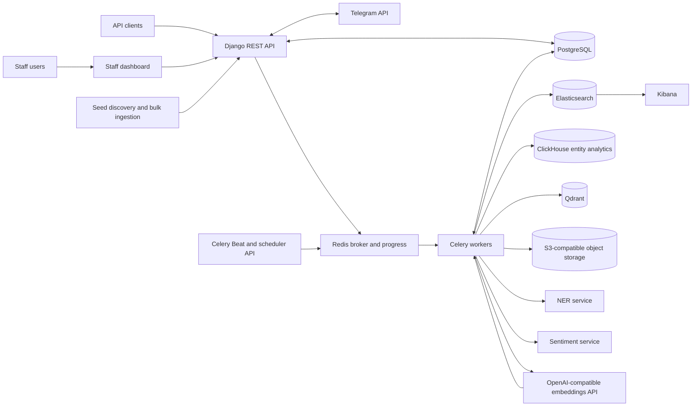
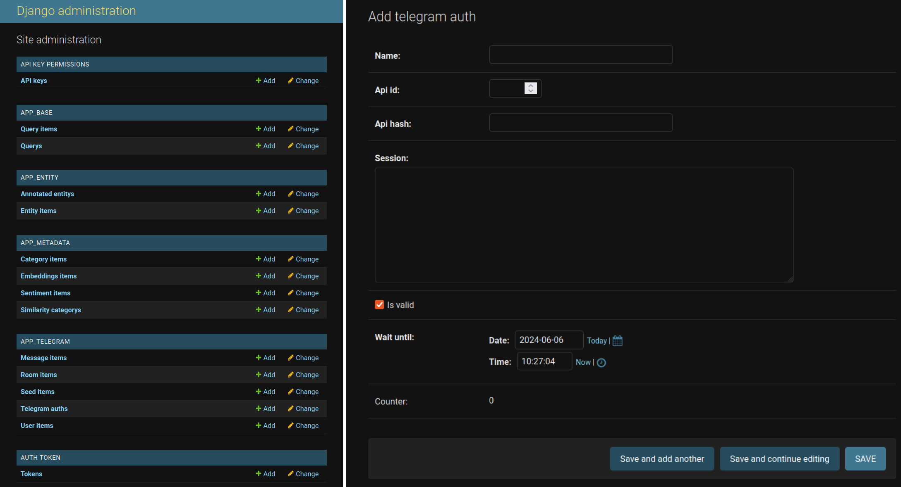

# Atenea API

Core Django REST Framework project for Atenea. It exposes the API used to ingest,
process, index, search, and analyze Telegram rooms and messages.

Main responsibilities:
- PostgreSQL persistence for structured data.
- Elasticsearch indexing and keyword search.
- Qdrant-backed vector storage and semantic search.
- Celery pipelines for long-running ingestion and processing tasks.
- Integration with local NER and sentiment microservices.
- Integration with an OpenAI-compatible embeddings provider.
- ClickHouse-backed entity analytics for the staff dashboard.
- A staff dashboard for activity statistics, search and Job management.

## Index
- [REST API usage](./docs/api_usage.md)
- [Environment file explanation](./docs/enviroments.md)
- [Required external models](./models/README.md)
- [Dev deployment](./docs/dev_deployment.md)
- [Production deployment](./docs/prod_deployment.md)
- [First configuration](./docs/configuration.md)
- [Testing strategy](./docs/testing.md)
- [Staff dashboard](./docs/dashboard.md)
- [Full documentation map](./docs/README.md)

## Architecture and Design

The main component is a modular Django REST Framework API that coordinates
ingestion, persistence, processing, and retrieval while delegating specialised
NLP and embedding workloads to external services.

Long-running ingestion and processing requests are executed asynchronously by
**Celery**, with **Redis** acting as broker and media-progress store. The main
pipelines include:

- seed population and room access recovery;
- room and comment scanning;
- NER extraction, sentiment analysis, categorization, and embeddings;
- Elasticsearch indexing and Qdrant vector synchronization;
- Telegram attachment metadata collection and selective S3-compatible storage;
- external cloud/download URL cataloguing.

Celery Beat and the scheduler API can run these operations recurrently for
continuous monitoring.

Moreover, the API integrates services for computationally intensive workloads,
allowing each processing component to scale independently. The local FastAPI
microservices can operate behind a load balancer, while embeddings are consumed
through an OpenAI-compatible endpoint and stored in Qdrant. Currently, the local
microservices are:
- NER service: specializes in Named Entity Recognition.
- Sentiment service: specializes in sentiment classification.

Finally, Kibana can be used by advanced users to create interactive dashboards for data visualization and analysis over Elasticsearch indexes.

### Platform architecture


1.  **Seed discovery and ingestion**: Telegram groups and channels can be identified manually or with external discovery tools. Atenea receives the selected resources through its bulk seed-ingestion API; web crawlers are not bundled with this repository.
    
2.  **Atenea API**:
    -   **Authorization**: This area ensures that only authorized users or systems can access some API endpoints, by using authentication tokens.
    -   **API Endpoints**: These are the interfaces through which clients interact with Atenea's services. They handle incoming requests and send back the appropriate responses.
    -   **ETL Pipelines**:
        -   **Message Broker**: A Redis database that queues messages (tasks) to be processed. It acts as a middleman between the API endpoints and the workers.
        -   **Workers**: These are background processes powered by Celery that execute tasks from the message broker, such as data ingestion and post-processing.
3.  **Storage and Database**:
    -   **Relational Database**: A PostgreSQL database used for structured data storage.
    -   **Elasticsearch**: Search indexes optimized for lexical and structured information retrieval.
    -   **Qdrant**: A vector database used for message embeddings and semantic search.
    -   **S3-compatible object storage**: Stores selectively downloaded Telegram media. PostgreSQL retains the associated filename, MIME type, size, SHA-256 hash, status, object key, and message/room provenance.
4.  **Kibana**: A data visualization dashboard for Elasticsearch that provides visualization capabilities on top of the content indexed on an Elasticsearch cluster.
5. **External APIs**:
    -   **Telegram API**: Telegram API for downloading data.
6.  **Load Balancer**: This component distributes incoming network traffic across multiple instances of the API NER service, ensuring no single server bears too much demand.
	- **API NER**: A microservice used by the platform to perform Named Entity Recognition (NER) during data ingestion.
	- **API Sentiment**: A microservice used by the platform to classify sentiment labels.
7.  **Embeddings provider**: An OpenAI-compatible embeddings API, such as OpenAI, vLLM, or Ollama. Atenea stores the resulting vectors in Qdrant.
    
8.  **Clients**: These are the end-users or systems that make requests directly to the API.
    
The entire Atenea platform is built on Django REST Framework for the backend, utilizes FastAPI for microservices development, and employs Kibana for data visualization.

This architecture supports the extraction and monitoring of data from Telegram channels. It is designed to detect organized attacks, misinformation, and spam by providing advanced search capabilities and data analysis tools to understand the flow of information over time.

### API design

#### General Endpoints
|                | Path                                | Description                                      |
|----------------|-------------------------------------|--------------------------------------------------|
| Tags           | `/api/v1/front/form/tags`           | Retrieve a list of tags.                         |
| Languages      | `/api/v1/front/form/languages`      | List available languages.                        |
| List Categories| `/api/v1/metadata/category`         | Retrieve a list of categories.                   |
| Scheduled Tasks| `/api/v1/scheduler/task`            | Create, inspect, update, or delete recurrent Celery tasks. |


#### Data Ingestion Endpoints
|                | Path                              | Description                                       |
|----------------|-----------------------------------|---------------------------------------------------|
| Category Bulk    | `/api/v1/metadata/category/bulk` | Inserts categories from a JSON list and calculates their embeddings. |
| Seed Bulk        | `/api/v1/tg/seed/bulk`          | Inserts Telegram seed links from a JSON list. |
| Seed Populate    | `/api/v1/tg/seed/populate`      | Takes previous ingested Telegram links and starts populating them using the Telegram API. |
| Scan Room        | `/api/v1/tg/room/scan`          | Starts scanning already populated Telegram groups/channels. |
| Recover Room Access | `/api/v1/tg/room/access`      | Recalculate access data for rooms that can no longer be reached with their stored credential. |


#### Data Processing Endpoints
|                | Path                              | Description                                       |
|----------------|-----------------------------------|---------------------------------------------------|
| Scan Comments   | `/api/v1/tg/msg/scan`            | Scan discussion comments associated with selected channel messages. |
| NER             | `/api/v1/tg/msg/ner`             | Process Named Entity Recognition (NER) on messages. |
| Embed           | `/api/v1/tg/msg/embed`           | Calculate message embeddings through the configured OpenAI-compatible provider and store vectors in Qdrant. |
| Categorize      | `/api/v1/tg/msg/categorize`      | Categorize messages with embedding-based category matching. |
| Sentiment       | `/api/v1/tg/msg/sentiment`       | Classify sentiment labels for messages.           |
| Index Messages  | `/api/v1/tg/msg/index`           | Index messages in Elasticsearch.                  |
| Vector Status   | `/api/v1/tg/msg/vector`          | Inspect vector synchronization state for messages. |
| Download Media  | `/api/v1/tg/msg/media/download`  | Catalogue Telegram media metadata or selectively download matching files into S3-compatible storage. Supports room/tag, date, language, extension, and size filters, plus `metadata_only=true`. |
| Media Progress  | `/api/v1/tg/msg/media/download/status` | Inspect Redis-backed progress for a media download token. |
| Collect URLs    | `/api/v1/tg/msg/external-url/collect` | Store whitelisted external cloud/download URLs from already scanned messages without downloading them. |
| Delete Media    | `/api/v1/tg/msg/downloadable` (`DELETE`) | Preview (`dry_run=true`) or delete scoped downloaded objects while retaining deletion state in PostgreSQL. |


#### Search endpoints
The main search routes are stable. Query parameters, filters, ordering fields,
and pagination details are documented in the Swagger schema.

|                | Path                                    | Description                                               |
|----------------|-----------------------------------------|-----------------------------------------------------------|
| Stored Messages | `/api/v1/tg/msg`                    | Retrieve PostgreSQL messages with signed cursor pagination. |
| Message Count | `/api/v1/tg/msg/count`                  | Count the complete filtered PostgreSQL message selection. |
| Vector Count | `/api/v1/tg/msg/vector/count`            | Count filtered messages that have embeddings. |
| Search Message | `/api/v1/tg/msg/search`                 | Elasticsearch message search.                      |
| Smart Msg Search | `/api/v1/tg/msg/ai`                   | Qdrant-backed semantic message search.             |
| Downloadable Catalog | `/api/v1/tg/msg/downloadable`     | Retrieve Telegram media metadata, signed links for stored objects, and whitelisted external URLs grouped by room. |
| Search Room    | `/api/v1/tg/room/search`                | Elasticsearch room search.                         |
| Room Suggest   | `/api/v1/tg/room/search/suggest`        | Get room suggestions.                              |
| Message Statistics | `/api/v1/stats/msg`                 | Aggregate message counts by day, week, month, or year, optionally calculating a z-score. |


For `/api/v1/tg/msg` and `/api/v1/tg/msg/vector`, start without a cursor and
follow the response's `next` link until it is `null`. The defaults are 100
messages and 10 vectors, with a maximum `page-size` of 100. These lists return
`next`, `previous`, `token`, and `results`; request their separate `/count` routes
only when a total is needed. Sending `page` to either list returns HTTP 400.
Counts and cursor traversal read live data rather than a fixed snapshot.
PostgreSQL `tag` filters use complete, case-sensitive tag values.
`tag_match=any` matches an item with at least one supplied tag;
`tag_match=all` requires every supplied tag.
The staff dashboard at `/dashboard/` opens a message activity overview with
one frequency chart with an optional z-score overlay. It reuses the statistics service, with quick or
custom date ranges, interval selection, room/tag/reply filters, linked tooltips,
chart zoom, and CSV export. Date and scope edits wait for Reload; quick ranges
and drag-to-zoom apply immediately. Statistics load asynchronously through the staff
session; controls stay usable and the previous charts remain visible during
refreshes. See [the dashboard guide](docs/dashboard.md) for details.

The staff dashboard's Search tab uses its Text Mode switch to choose between
Elasticsearch text search and stored-message retrieval. Retrieval uses the
allowlisted `MessageRetrievalFilterSerializer` filters and signed cursors.
Text Mode applies the existing `MessageSearchView` filters in-process, without
an HTTP request to the search endpoint; it keeps that view's page-number
pagination.
In Elasticsearch Text Mode, the Dashboard also accepts quoted phrase searches
joined by `AND` or `OR`, for example `"Perro Sanchez" AND "Almeida"` or
`"Perro Sanchez" OR "Almeida"`. `AND` requires every phrase; `OR` matches
any phrase and is the default for repeated phrases. Phrase matching follows
Elasticsearch's text analyzer. This supports quoted phrases with one boolean
operator, not the full set of Google search operators.

Any additional endpoint can be found on the documentation page, http://127.0.0.1:8000/swagger

### Platform Workflow

#### Tags as collection selectors
Tags are user-defined labels assigned to seeds to organise related Telegram
resources into reproducible collections, for example `collection-june-2026`, `spain-elections`, or
`project-x`. When a seed is populated, its tags are propagated to the resulting
room. Message operations then select messages through the tags of their source
rooms, so the same collection identifier can be reused across the complete
workflow:

```text
seed ingestion -> room population -> scanning -> enrichment/indexing
-> attachment processing -> statistics and retrieval
```

For example, `tag=darkgram` restricts each compatible endpoint to rooms derived
from that collection and to their messages. Multiple `tag` parameters can be
combined with `tag_match=any` (the default) or `tag_match=all`. Tags are
collection metadata; they are distinct from Telegram hashtags, extracted
entities, and embedding-based categories.

#### 1. Channel/group scouting
First, identify the Telegram channels or groups to monitor, either manually or with an external discovery process. Submit the selected links to Atenea through the bulk seed-ingestion endpoint described below.

#### 2. Enabling the Telegram API
To use the Telegram API for data extraction, access credentials associated with a phone number are required. These accounts can be easily added from the administration panel in the TelegramAuth model (http://127.0.0.1:8000/admin/app_telegram/telegramauth/).



- When the platform receives a request related to data extraction from Telegram, it automatically distributes the load among the available credentials.
- Each credential can perform up to 200 `ResolveUsername` operations per day. This limit applies to resolving new usernames, not to scanning messages from known rooms. Once a room has been resolved, Atenea reuses its Telegram ID and access hash, allowing substantially larger message volumes to be monitored.
- If Telegram returns a `FloodWait`, Atenea records the waiting period and avoids reusing the affected credential until it becomes available.
- This system allows for a straightforward increase in data extraction capacity by adding more credentials.

#### 3.1 ETL Pipeline: Create seeds 
Once channels have been selected, call `/api/v1/tg/seed/bulk` and assign the
tags that identify their collection:
```
[
    {
        "link": "https://t.me/<CHANNEL>",
        "tags": [
            "tag1",
            "tag2"
        ]
    },
    {
        "link": "https://t.me/<CHANNEL>",
        "tags": [
            "tag1",
            "tag2"
        ]
    },
		...
]
```

#### 3.2 ETL Pipeline: Populate seeds to enable its monitoring
Each inserted link becomes a `SeedItem` waiting to be resolved into a monitorable room. Use `/api/v1/tg/seed/populate` to process selected seeds. Requests can be scoped by resource/title match, tag, language, resource type, and collection date.

#### 3.3 ETL Pipeline: Scan channels/groups to retrieve messages
Populated rooms can be scanned recurrently through `/api/v1/tg/room/scan`.
Rooms can be selected by name, tag, language, room type, or last-update range,
and each request can limit the number of messages retrieved per room. The
default scan workflow stores new messages and runs the configured text
post-processing and indexing stages. Channel comments can be collected
separately through `/api/v1/tg/msg/scan`.

#### 3.4 ETL Pipeline: Catalogue or preserve attachments
After messages have been scanned, `/api/v1/tg/msg/media/download` can catalogue
Telegram attachment metadata without transferring the payload
(`metadata_only=true`) or selectively store matching files in S3-compatible
object storage. Downloaded objects retain their source-message provenance,
SHA-256 hash, risk flags, and processing state. The same collection can also be
scanned for whitelisted external download URLs through
`/api/v1/tg/msg/external-url/collect`.

#### 4. Search and analyze data
Once the platform has a relevant amount of messages indexed in Elasticsearch, the search endpoint `/api/v1/tg/msg/search` will be ready for retrieval. It is also available to search by channels with the `/api/v1/tg/room/search` endpoint. Semantic search is available through `/api/v1/tg/msg/ai` when embeddings have been calculated and synchronized with Qdrant.

Message activity can be aggregated through `/api/v1/stats/msg`, while
downloaded media and external references can be retrieved through
`/api/v1/tg/msg/downloadable`. Stored media are exposed through temporary
S3-compatible presigned URLs rather than public bucket access. Kibana dashboards
can additionally be created over the Elasticsearch indexes.


