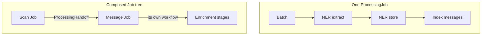
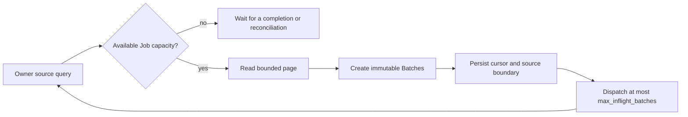
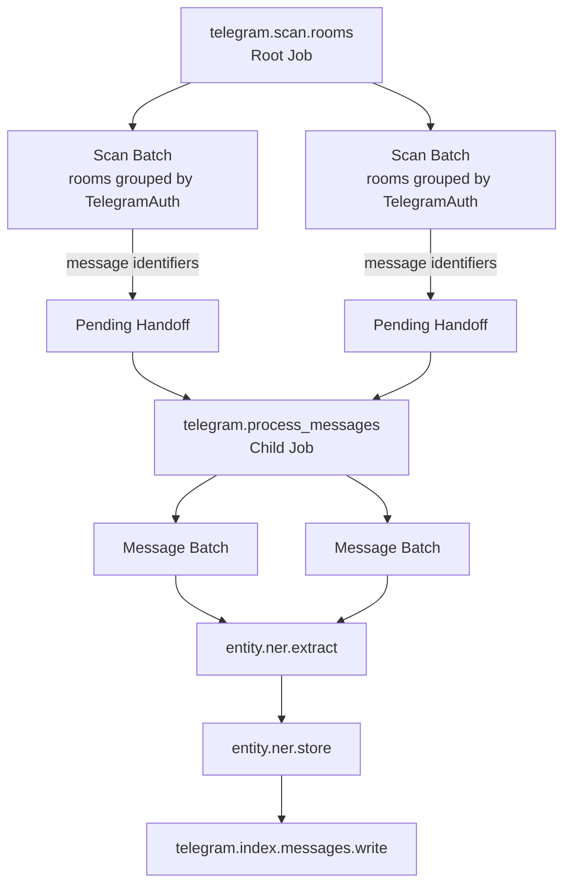
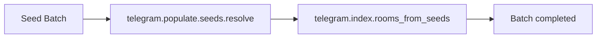
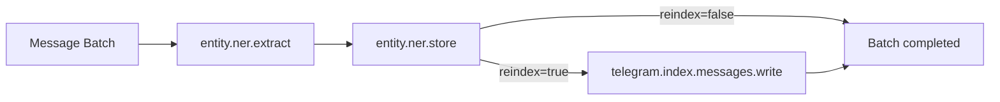
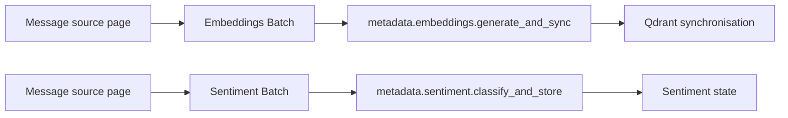

# Pipelines

## The two meanings of pipeline

In Atenea, a pipeline can be composed at two different levels:

1. **Stages inside one Job.** Every Batch in the Job runs the same ordered
   workflow. For example, a NER Batch runs extraction and then storage. The
   Batch advances from one stage to the next without creating another Job.
2. **Jobs connected by Handoffs.** A source Job can produce identifiers for a
   child Job. The child has its own workflow, capacity, counters and lifecycle.
   The connection is durable and incremental.



The first level is appropriate when a single source slice should pass through
known sequential stages. The second is appropriate when the output of one
operation is the input of another operation with a different source model,
capacity or lifecycle boundary.

## Design rules for a new pipeline

The scheduler is a generic execution protocol. New domain behaviour belongs in
the owning application, not in `app_scheduler.services.jobs`.

### 1. Define stable processor and stage keys

Keep the identifiers in a dependency-light `job_keys.py` module. The settings
module imports them while Django is initialising, so the key module should not
import models or services.

```python
# app_example/job_keys.py
EXAMPLE_PROCESSOR = "example.records"
EXAMPLE_NORMALISE_STAGE = "example.records.normalise"
EXAMPLE_PUBLISH_STAGE = "example.records.publish"
EXAMPLE_WORKFLOW = [EXAMPLE_NORMALISE_STAGE, EXAMPLE_PUBLISH_STAGE]
```

Stage keys are opaque to the scheduler. They must be unique within a workflow,
non-empty and stable over the lifetime of the records that use them. Renaming
a stage while Batches are in flight leaves those Batches with a stage that no
longer exists.

### 2. Register every stage with a task and queue

Add the stage to `PROCESSING_STAGE_TASKS` in the active Django settings:

```python
PROCESSING_STAGE_TASKS = {
    EXAMPLE_NORMALISE_STAGE: {
        "task": "app_example.tasks.normalise_batch",
        "queue": "example-q",
        "lease_seconds": 1200,
    },
    EXAMPLE_PUBLISH_STAGE: {
        "task": "app_example.tasks.publish_batch",
        "queue": "example-q",
        "lease_seconds": 1200,
    },
}
```

The generic dispatcher publishes only a Batch UUID to the configured task. A
stage-specific lease should be longer than the expected task duration and the
Celery visibility timeout should be longer than the longest hard task limit.

### 3. Create the Job through an owner-side helper

`create_processing_job` validates the workflow, stores the source definition,
calculates a stable fingerprint and applies active-work deduplication. It does
not query the source database and it does not create input Batches. Those are
responsibilities of the owning application.

An owner-side helper normally follows this shape:

```python
def create_example_job(*, filters=None, request_token=None, lifecycle_policy=None):
    filters = normalise_example_filters(filters)
    workflow = list(EXAMPLE_WORKFLOW)
    fingerprint = build_job_fingerprint(
        processor=EXAMPLE_PROCESSOR,
        mode=ProcessingJob.BACKFILL,
        workflow=workflow,
        filters=filters,
    )
    job, created = create_processing_job(
        processor=EXAMPLE_PROCESSOR,
        mode=ProcessingJob.BACKFILL,
        workflow=workflow,
        filters=filters,
        batch_size=settings.EXAMPLE_BATCH_SIZE,
        max_inflight_batches=settings.EXAMPLE_MAX_INFLIGHT,
        request_token=request_token,
        source_snapshot_at=timezone.now(),
        fingerprint=fingerprint,
        lifecycle_policy=lifecycle_policy,
    )
    if created:
        set_estimated_batches_total(job, example_queryset(job).count())
        transaction.on_commit(
            lambda job_id=job.id: enqueue_source_dispatch(job_id)
        )
    return job, created
```

The `lifecycle_policy` argument is meaningful for a scheduled launcher. A
manually created Job normally receives `None`, leaving the persisted policy
empty and disabling schedule-driven automatic finalisation.

The fingerprint represents the work, not the trigger. Two requests with the
same processor, mode, workflow and normalised filters identify equivalent
active work even if they came from different API calls. Schedule policy is
deliberately excluded so changing a trigger does not create duplicate work.

### 4. Materialise source input with bounded capacity

There are two common source patterns.

#### Static live input

The owner selects the current source set, creates all its Batches inside the
creation transaction, closes the input boundary and dispatches after commit.
Telegram room scans use this pattern. The source is grouped by credential and
each group is assigned a `resource_key` so that two Batches using one Telegram
credential are not run concurrently within that Job.

#### Cursor-driven backfill

The owner registers a Job first and uses a source dispatcher to read a bounded
page. The dispatcher creates only enough Batches for available capacity, saves
the last source cursor and marks `source_exhausted` when the page reaches the
end of the source. It does not advance the cursor while unqueued Batches from
the previous page remain pending.

This pattern keeps database work, memory use and broker traffic bounded even
when the source contains millions of records.



`create_batch_locked` must be called while the Job row is locked. It stores
source identifiers and starts every Batch at the first stage in the workflow.

### 5. Implement the stage task with the lease protocol

A durable stage task follows the same sequence regardless of its domain:

```python
@shared_task(bind=True, acks_late=True, task_reject_on_worker_lost=True)
def normalise_batch(self, batch_id):
    token = None
    try:
        with transaction.atomic():
            batch = (
                ProcessingBatch.objects
                .select_for_update()
                .select_related("job")
                .get(pk=batch_id)
            )
            token = begin_batch_stage_locked(
                batch,
                EXAMPLE_NORMALISE_STAGE,
            )
            if token is None:
                return {"batch_id": str(batch_id), "status": batch.status}
            item_ids = list(batch.item_ids)

        result = normalise_items(item_ids)

        with transaction.atomic():
            batch = (
                ProcessingBatch.objects
                .select_for_update()
                .select_related("job")
                .get(pk=batch_id)
            )
            ensure_stage_lease_locked(
                batch,
                stage=EXAMPLE_NORMALISE_STAGE,
                token=token,
            )
            complete_batch_stage_locked(
                batch,
                stage=EXAMPLE_NORMALISE_STAGE,
                token=token,
                processed_count=result.processed,
                stage_summary=result.summary,
            )
    except Exception as exc:
        return retry_or_fail_stage(self, batch_id, exc, token=token)
```

The production tasks use the corresponding application-specific retry helper,
but the contract is the same:

1. lock and claim the current stage;
2. perform API, database or model work outside the state transaction;
3. lock again and verify the lease token;
4. either advance the Batch, persist a retry delay or mark the Batch failed.

Do not use a Celery chain as the only representation of stage progress. A
worker may disappear after a task is accepted, a broker message may be
redelivered and a stage may need to be retried independently. The database
state and lease protocol make those cases recoverable.

### 6. Compose separate Jobs with Handoffs

Create the child Job as part of the same application-owned composition. The
child is normally created before the first source Batch runs, but it can only
process input once a Handoff has been materialised.

```python
root, created = create_processing_job(
    processor=SOURCE_PROCESSOR,
    mode=ProcessingJob.LIVE,
    workflow=[SOURCE_STAGE],
    filters=filters,
    batch_size=settings.SOURCE_BATCH_SIZE,
    max_inflight_batches=settings.SOURCE_MAX_INFLIGHT,
    parent_job=None,
    lifecycle_policy=lifecycle_policy,
)

child, _ = create_processing_job(
    processor=TARGET_PROCESSOR,
    mode=ProcessingJob.LIVE,
    workflow=TARGET_WORKFLOW,
    filters={"source": SOURCE_PROCESSOR, "parent_job": str(root.id)},
    batch_size=settings.TARGET_BATCH_SIZE,
    max_inflight_batches=settings.TARGET_MAX_INFLIGHT,
    parent_job=root,
    deduplicate=False,
)
```

When a source stage commits output, create Handoffs in that same transaction:

```python
create_handoffs_locked(
    source_batch,
    target_job=child,
    item_content_type=message_content_type(),
    item_ids=message_ids,
)
complete_batch_stage_locked(
    source_batch,
    stage=SOURCE_STAGE,
    token=token,
)
```

The Handoff dispatcher later creates target Batches according to the child's
capacity. The source Batch must not create target Batches directly: the target
Job owns its own batch size, capacity and input accounting.

For a scheduled composed pipeline, the lifecycle policy is attached to the
root Job. The scheduler finalises the root and walks the complete Job tree;
child Jobs do not need a separate copy of the schedule context.

## Current pipeline catalogue

The public scheduler registry is defined in
[`app_scheduler.registry`](../../app_scheduler/registry.py). The
following table describes the pipelines currently registered for schedules.

| Public pipeline key | Root processor | Mode | Workflow and topology |
| --- | --- | --- | --- |
| `telegram.scan.rooms` | `telegram.scan.rooms` | `live` | Root stage `telegram.scan.rooms.collect_messages`; creates child `telegram.process_messages` with `entity.ner.extract` → `entity.ner.store` → `telegram.index.messages.write`. [Guide](telegram-room-scan.md) |
| `telegram.scan.comments` | `telegram.scan.comments` | `backfill` | Cursor-driven parent-message batches; root stage `telegram.scan.comments.collect_comments` creates the same LIVE message-processing child workflow as a room scan. [Guide](scan-comments.md) |
| `telegram.populate` | `telegram.populate` | `live` | One Job: `telegram.populate.seeds.resolve` → `telegram.index.rooms_from_seeds`. [Guide](telegram-populate.md) |
| `telegram.access.rooms` | `telegram.access.rooms` | `live` | One Job: `telegram.access.rooms.resolve_hashes`. [Guide](telegram-access.md) |
| `telegram.index.messages` | `telegram.index.messages` | `backfill` | One Job: `telegram.index.messages.write`. [Guide](telegram-index-messages.md) |
| `entity.ner.backfill` | `entity.ner` | `backfill` | One Job: `entity.ner.extract` → `entity.ner.store`; the `reindex` option appends `telegram.index.messages.write`. [Guide](entity-ner-backfill.md) |
| `metadata.embeddings` | `metadata.embeddings` | `backfill` | One Job: `metadata.embeddings.generate_and_sync`. [Guide](metadata-embeddings.md) |
| `metadata.sentiment` | `metadata.sentiment` | `backfill` | One Job: `metadata.sentiment.classify_and_store`. [Guide](metadata-sentiment.md) |

### Manual endpoint status examples

The mode alone does not determine whether a Job is RUNNING or COLLECTING.
Static endpoints can create all source Batches and close their input before
workers start; a composed child can remain open while its parent sends output.

| Endpoint | Root Job | Child Job | Why |
| --- | --- | --- | --- |
| POST /api/v1/tg/room/scan | LIVE + RUNNING after room Batches are created | LIVE + COLLECTING while scans can still hand off messages | The room list is selected up front; the root has no more direct room input, but the child may receive new messages. |
| POST /api/v1/tg/msg/scan | BACKFILL + RUNNING during cursor discovery | LIVE + COLLECTING until the root stops producing comments | The root pages through stored parent messages; the child receives recovered comments incrementally. |

After the room scan root finishes all room Batches, or after the comments
source is exhausted and its remaining scan Batches finish, the child input is
closed. The child then runs its received message Batches to completion. These
examples are expanded in the [room scan](telegram-room-scan.md) and
[comments scan](scan-comments.md) guides. The general resume rule is in the
[processing model](../processing-model.md).

### Telegram room scan

The room scan is the principal example of a composed pipeline:



Each scan Batch is grouped by Telegram credential and carries the target
message Job identifier in its processor metadata. The scan task writes
messages and creates Handoffs in the same transaction as the durable scan
output. A scan Batch can therefore complete while other room groups are still
being scanned, and its messages can enter NER immediately.

The child Job is not completed merely because the parent has no currently
running Batch. Its input boundary must be closed and all materialised child
Batches and pending Handoffs must settle first.

Comment scans use explicit parent-message IDs and commit one parent at a time.
The source pages known ingestion dates and then historical NULL dates, keeping
the cursor and page batches atomic. See [Scanning channel comments](scan-comments.md)
for date filters, per-parent locks, retry progress and deployment requirements.

### Populate and index rooms

Populate uses one Job with two stages:



Each Batch is assigned to a Telegram credential. Populate intentionally has no
automatic Celery retry: unresolved or rate-limited seeds remain eligible for a
later populate run, while a worker failure is available for an explicit Job
retry.

### NER with optional indexing

The standard NER backfill ends after storage. When `reindex=true`, the owner
adds the existing message-index stage to the same workflow:



This is one Job and one Batch workflow. It is not three child Jobs.

### Metadata processing

Embeddings and sentiment are independent backfill Jobs. Their source
dispatchers use a cursor and bounded pages, and their domain state determines
which messages remain eligible:



## Pipeline guides

Each guide documents the source filters, input boundary, batching, external
work, persisted outcomes, retries and operational recovery for its flow:

* [Telegram room scan](telegram-room-scan.md)
* [Channel comments scan](scan-comments.md)
* [Seed population and room indexing](telegram-populate.md)
* [Room access recovery](telegram-access.md)
* [Message indexing](telegram-index-messages.md)
* [NER backfill](entity-ner-backfill.md)
* [Embeddings](metadata-embeddings.md)
* [Sentiment](metadata-sentiment.md)

## Queues, capacity and retries

Stage execution is configured centrally, while the tasks remain in their
owning applications. The current queue mapping is:

| Stage family | Queue | Typical task retry setting |
| --- | --- | ---: |
| NER extraction | `ner-live-q` or `ner-backfill-q` | `NER_EXTRACT_MAX_RETRIES=3` |
| NER storage | `ner-store-q` | `NER_STORE_MAX_RETRIES=10` |
| Room and comment scans | `telegram-scan-q` or `telegram-scan-comments-q` | `TELEGRAM_SCAN_MAX_RETRIES=3` |
| Populate and access recovery | `telegram-populate-q` | Populate: `0`; access: `TELEGRAM_ACCESS_MAX_RETRIES=3` |
| Message and room indexing | `index-q` | `INDEX_MAX_RETRIES=3` |
| Embeddings | `embed-q` | `METADATA_MAX_RETRIES=3` |
| Sentiment | `sentiment-q` | `METADATA_MAX_RETRIES=3` |

The retry setting is the number of Celery retries after the first delivery. In
the usual case, `max_retries=3` permits four executions in total. A stage task
marks the Batch `FAILED` only when that retry budget is exhausted. The Job
then becomes `WAITING_RETRY`, not silently `COMPLETED`.

The most important capacity settings and their current defaults are:

| Setting | Default | Scope |
| --- | ---: | --- |
| `PROCESSING_BATCH_LEASE_SECONDS` | `1200` seconds | Generic fallback lease. A stage-specific lease takes precedence. |
| `NER_BATCH_SIZE` | `10000` | NER backfill Batch size. |
| `TELEGRAM_SCAN_ROOMS_PER_BATCH` | `300` | Rooms per normal scan Batch. |
| `TELEGRAM_SCAN_COMMENTS_MESSAGES_PER_BATCH` | `300` | Parent-message IDs per comments Batch. |
| `TELEGRAM_SCAN_MAX_INFLIGHT` | `4` | Concurrent scan Batches in one scan Job. |
| `TELEGRAM_POPULATE_SEEDS_PER_BATCH` | `200` | Seeds per populate Batch. |
| `TELEGRAM_ACCESS_ROOMS_PER_BATCH` | `200` | Rooms per access-recovery Batch; the implementation rejects larger values because of Telegram's daily lookup limit. |
| `INDEX_MANUAL_BATCH_SIZE` | `100000` | Message IDs per manual index Batch. |
| `EMBEDDINGS_BATCH_SIZE` | `10000` | Message IDs per embeddings Batch. |
| `SENTIMENT_BATCH_SIZE` | `10000` | Message IDs per sentiment Batch. |
| `NER_RECONCILE_INTERVAL_SECONDS` | `60` seconds | Beat interval for lease recovery, due retries and scheduled lifecycle reconciliation. |

The complete environment reference, including time limits, worker concurrency
and visibility timeout guidance, is in
[`enviroments.md`](../enviroments.md).
