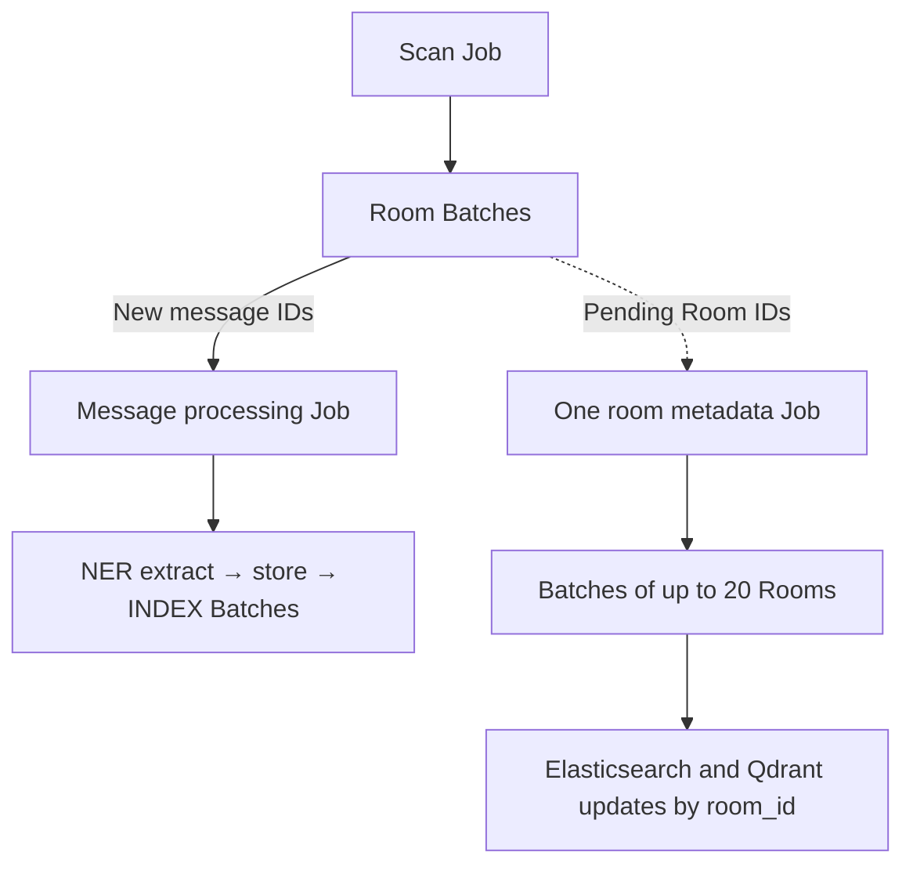

# Telegram room scan

The room scan reads recent Telegram messages from the rooms selected for a
request and sends each newly stored message to the message-processing child
Job. It is the main example of a composed pipeline: room collection and
message enrichment have separate Jobs, counters, capacity and recovery.

## Launch and topology

Manual endpoint: `POST /api/v1/tg/room/scan`

Scheduled pipeline key: `telegram.scan.rooms`

The endpoint returns the selected room count, the root Job ID and the child
message-processing Job ID. The count describes rooms selected for this run,
not messages recovered from Telegram.

| Job | Mode | Workflow | Input lifecycle |
| --- | --- | --- | --- |
| Root room scan | `LIVE` | `telegram.scan.rooms.collect_messages` | Rooms are selected and batched at launch; the root input is then closed and the Job runs its existing Batches. |
| Child message processing | `LIVE` | `entity.ner.extract` → `entity.ner.store` → `telegram.index.messages.write` | Starts with open input in `COLLECTING` and accepts message IDs through Handoffs. It closes only when the root can produce no more Handoffs. |
| Conditional room metadata child | `LIVE` | `telegram.room_metadata.sync.write` | Created once per source Job when a Room needs synchronization; accepts Room IDs through Handoffs and closes with the source. |



The root is `LIVE` even though it performs a finite scan: `LIVE` describes the
kind of source operation, while the fixed room list is closed after its
Batches are built. The root runs while those Batches scan Telegram. Its child
can process the first `Handoff` before the other rooms finish.

The operational sequence is: the endpoint selects rooms and creates root
Batches; a worker scans a room Batch and stores messages; the same transaction
records a durable `Handoff` with the new message IDs; the child materializes
that `Handoff` when it has capacity and runs NER, storage and indexing. Other
room Batches can still be scanning during child processing.

Message persistence and creation of its `Handoff` happen in the same database
transaction. If publication is interrupted after commit, the durable `Handoff`
can be published again. See the [processing model](../processing-model.md) for
the generic lease and handoff protocol.

The root finishes when its own scan Batches finish. Its message-processing
child can remain running or waiting for retry afterward. The next scheduled
scan is therefore free to collect new messages while an older NER/index Job
recovers. Automatic scan finalisation abandons only failed scan input; it never
abandons persisted message processing. The parent dashboard exposes a retry
action for recoverable child failures.

## Room selection and scan behaviour

The request selects rooms that are valid, public, not deleted and currently
followed. Optional filters narrow the selection by room name, tags, language,
channel status and last-update date. Tag matching can require any selected tag
or all selected tags.

The scan reads up to `max_msgs` Telegram records from each selected room in one
execution. The default is 2500; the endpoint accepts 10 through 50000. Service
records may consume Telegram's fetch limit without becoming stored messages.
The `update_users` option is false by default and controls whether the scan also
refreshes user records.

### Optional room identity check

`check_room` is an optional boolean, defaulting to `false`, in both the scan
endpoint and scheduled `telegram.scan.rooms` parameters. Existing schedules and
stored batches without this option retain the disabled behaviour. Enable it on
periodic review scans, for example:

```json
{"room": ["TSANoticias"], "max_msgs": 100, "check_room": true}
```

The enabled check uses the first history message whose chat includes the expected
Telegram ID, username and title; reduced (`min`) entities can supply these fields.
An empty history, missing fields or an absent username triggers one explicit lookup
by Telegram ID and the credential-bound access hash. Telegram ID determines room
identity; current and historical usernames never merge rooms. Public username
comparison ignores case. A public username still missing after that lookup marks
the room private and defers message persistence without advancing the offset.

If the observed username, canonical Room link or title differs, the extraction
also makes one `GetFullChannelRequest` to read the current description. It does
not fetch full metadata for unchanged Rooms, so an about-only change cannot
activate a regular scan reconciliation. A failed description lookup defers the
Room with `room_about_unavailable`, without persisting messages, metadata or
offset advancement. Credential rate limits and authentication failures retain
their existing handling. The lookup runs before writes within the scan's
existing locked checkpoint, like message extraction.

A rename updates the Room's current username, title and canonical link, and
rewrites only that Room's historical message prefixes, preserving post/comment
suffixes. Reconciliation also updates the description when it was fetched.
`username_history` exposes read-only entries with `username`, `title`, `about`
and `detected_at` in UTC. Each value is the previous value if that field changed,
or null if it did not. Simultaneous changes share one entry; a title-only or
about-only change has a null username. A previous empty description is `""`,
including a previous SQL NULL; NULL and empty descriptions compare equally.
`detected_at` is the observation time, not Telegram's unknown actual change time.
Repeated checks do not duplicate history entries. Historical message-prefix
repairs retain their username-only entries, with null title and about.

For example, a title change without a username or description change produces:

```json
{"username": null, "title": "Previous title", "about": null, "detected_at": "2026-10-22T10:00:00+00:00"}
```

Legacy history entries use `"unknown"` for unavailable title/about values.
These values must not be interpreted as confirmed changes. Existing usernames
and observation timestamps remain available.

URL destinations are checked before insertion. With `check_room=false`, a
collision defers that room without identity requests or offset advancement.
With it enabled, historical owners are refreshed through their own Telegram
credentials and reconciled first. Unavailable owners, cyclic claims and row
lock contention defer affected rooms. Message row locks use NOWAIT to avoid
waiting on a comment parent that is itself waiting for the Room lock. Comment
persistence rebases fetched URLs against the current locked Room link.

Reconciliation records changed model fields in the internal
`Room.metadata_sync_pending_fields` list and renews `metadata_sync_pending_at`.
New changes accumulate until synchronization succeeds: a later title change
cannot erase a pending username change. A null timestamp means there is no
known pending metadata change. Reliable checks
update `username_checked_at` even without a rename; they do not create sync work.
Repairing only message URLs also creates no synchronization work unless Room
fields or history change. Title/about checks do not query PostgreSQL messages;
message URL reconciliation runs only for username/link changes or forced repairs.
The checkpoint collects affected Room IDs, including historical URL owners, and
records Handoffs to a single `telegram.room_metadata.sync` child in the same
transaction as Room updates, message URLs, messages and offsets. Publication is
after commit. Without changes or pending Rooms, this child is absent.

The metadata child and the message-processing child run independently. Every
new message already has the current public URL before insertion; normal search
and embedding writers reload Room metadata before writing. PostgreSQL advisory
locks serialize writers per Room, including across Jobs. They do not retain
Room row locks during HTTP, and provider/NER calculation stays outside them.
Waiting for another writer or an active Elasticsearch task defers work without
spending the bounded error retry budget.

Each metadata Batch contains up to 20 Rooms, packed by source Batch using the
scheduler's Handoffs. It always indexes the pending Room document. Message and
vector operations depend on the accumulated fields:

| Changed field | PostgreSQL messages (in reconciliation) | Elasticsearch messages | Qdrant |
| --- | --- | --- | --- |
| `title` | None | None | None |
| `about`, `tags` | None | Update metadata | None |
| `unique_name` | Repair URLs | Update metadata | Patch `room_unique_name` |
| Message URL repair without username change | Repair affected URLs | None | None |
| `lang`, `is_channel`, `created_at`, history, canonical `link` only | None except link reconciliation | None | None |

Combined changes execute the union of required operations. Elasticsearch uses
an asynchronous `update_by_query` filtered by `room_id` to patch `room_name`,
`room_about` and `tags`, retaining the equality/noop check. Message documents do
not store their public URL. Qdrant `set_payload` uses the same stable ID to patch
existing points while preserving vectors and other payload. Skipped operations
count zero updated messages. The child worker reads no message
history, enumerates no point IDs and maintains no message cursor or date cutoff.
NER, embedding generation and ClickHouse facts are not repeated by this child.

Per-Room Batch progress records the target timestamp, Elasticsearch request/task
IDs, acknowledged document counts and errors. Retries resume active search tasks
and skip confirmed Rooms. A lost submission response can be recovered through
its `X-Opaque-Id`. All writers drain registered search tasks before another write
to that Room. Search conflicts, timeouts or partial failures retain pending work.
Qdrant counts are not inferred from PostgreSQL. A failed Room does not prevent
the other Rooms in its Batch from being processed.

Only after all required operations succeed does the worker conditionally clear
the fields and captured pending timestamp together. Any concurrent change
replaces that timestamp and remains pending for another pass. Pending timestamps
without a field list receive one full synchronization for compatibility with
older workers; newer changes preserve that full scope when merging. Legacy
one-Room Batches use this same filtered operation once;
their message cursors are ignored and historical Jobs are retained.

The public API exposes history but not the internal synchronization fields.
Search can retain the previous metadata until the child finishes; PostgreSQL
URLs are already reconciled at scan commit.

Each root Batch contains room IDs, not message IDs. Rooms are grouped by the
credential that can access them, and a Batch receives a resource key for that
credential. This prevents two Batches in the same Job from concurrently using
one Telegram credential while still allowing different credentials to work
in parallel.

The selected room set is the input boundary for this execution. A later
request is needed to scan rooms newly matching the filters. This differs from
the comments pipeline, whose root Job discovers source messages page by page.

## Capacity and configuration

| Setting | Default | Meaning |
| --- | ---: | --- |
| `TELEGRAM_SCAN_ROOMS_PER_BATCH` | 300 | Maximum room IDs in one scan Batch. Rooms are grouped by Telegram credential before they are chunked into Batches. |
| `TELEGRAM_SCAN_MAX_INFLIGHT` | 4 | Maximum active scan Batches in the root Job. |
| `TELEGRAM_ROOM_METADATA_ROOMS_PER_BATCH` | 20 | Maximum Room IDs in a metadata Batch; final source fragments may be smaller. |
| `TELEGRAM_ROOM_METADATA_MAX_INFLIGHT` | 2 | Maximum active metadata Batches per metadata Job. |
| `TELEGRAM_SCAN_MAX_RETRIES` | 3 | Automatic stage retries after the first delivery. |
| `TELEGRAM_SCAN_SOFT_TIME_LIMIT` | 7200 seconds | Soft worker limit. |
| `TELEGRAM_SCAN_TIME_LIMIT` | 7800 seconds | Hard worker limit. |
| `TELEGRAM_SCAN_LEASE_SECONDS` | 8400 seconds | Lease used for recovery of a scan Batch. |
| `QUEUE_TELEGRAM_SCAN_CONCURRENCY` | 1 | Worker processes configured for the room-scan queue. |

Inside one Batch, the service commits checkpoints of up to **6 rooms**. This
size is independent of its maximum of **8 concurrent extraction operations**
(message history or participants). One Telegram client and event loop are
reused across checkpoints. The service parameters `rooms_per_checkpoint` and
`max_concurrent_operations` control these limits; they are different from
`TELEGRAM_SCAN_ROOMS_PER_BATCH`, which bounds the durable Batch's input list.

Even if the room list is larger, the dispatcher sends at most the configured
number of root Batches at once. The child message Job has its own batch size
and capacity; it does not inherit the root's room-batch settings.

## Results, retries and recovery

The root stage scans each room, persists messages and records message IDs for
the child. The child then runs NER extraction, stores extracted entities and
annotations, and indexes the message documents.

Each checkpoint has its own database transaction. It locks only that round's
rooms and commits messages, room offsets, users, relationships, Query links,
Handoffs and `ProcessingBatch.processor_metadata.room_progress` together. A
checkpoint is never marked confirmed before its data is durable. The service
logs each commit. Its preventive ten-second pause after 60 scanned rooms is
outside the checkpoint transaction, so it retains no room locks during that
pause.

For example, a Batch with 100 rooms commits the first 96 in sixteen rounds.
If room 99 triggers a surfaced FloodWait, the active round (rooms 97–100)
rolls back, including any partial results received in that round. The first
96 rooms remain stored. The retry reads durable progress and scans only the
four uncommitted inputs, without changing the original `item_ids`. Counters
and summaries include all confirmed rounds across attempts, not only the
latest attempt's timestamps.

The existing deferred-room semantics are retained: locked/missing rooms,
changed credentials or an extraction that returns no room update are recorded
as deferred outcomes of that checkpoint. They can be selected by a future
scan; they do not silently become completed scans. A FloodWait, database error
or cancellation instead leaves the active round uncommitted and retryable.

| Situation | Effect |
| --- | --- |
| Scan succeeds with no new messages | The room Batch completes; it produces no message `Handoff`. |
| Scan recovers messages | Messages and their `Handoff` are committed together; child Batches can start while other rooms are in progress. |
| Short FloodWait at or below Telethon's configured threshold | Telethon sleeps and retries that Telegram request inside the current worker. |
| FloodWait surfaced by Telethon | Only the active checkpoint rolls back; earlier rounds remain committed. The credential's `wait_until` is persisted and the Batch enters `RETRY_WAIT` until one minute after that deadline. It resumes only uncommitted rooms and does not consume the generic retry budget. |
| Telegram rejects the credential/session | The credential is marked invalid and the active checkpoint rolls back. Pending rooms follow the stage retry and exhaustion policy. |
| Transient error that propagates from extraction or persistence | The active round rolls back; the root Batch retries pending rooms within `TELEGRAM_SCAN_MAX_RETRIES`. |
| Retry budget is exhausted | Only pending rooms count as failed. The root Job exposes a failed Batch and normally moves to `WAITING_RETRY`; earlier checkpoint counts and child work remain recorded. |
| Child NER or indexing fails | The child Batch can be retried independently; completed root scans do not need to be repeated. |
| Worker loses its lease | The late worker cannot commit; lease reconciliation republishes eligible work. |
| Root is paused during a round | The current round commits; later rounds wait for resume. The Batch retains its confirmed room progress. |
| Client cleanup fails after the last checkpoint | The stage completes from durable progress; no room is scanned again. |

The root is complete only after its room Batches settle. The child is complete
only after its input is closed, pending Handoffs are materialised, and all
received message Batches settle. Thus root and child can show different active
statuses at the same time.

## Counts and launch response

The launch response includes the room estimate, root Job ID and child Job ID.
The root's input and stage summaries count rooms and scanned messages. The
child has separate message, NER, and indexing counters. A room count is not a
promise that each room yields that many messages: rooms may be empty,
inaccessible or subject to Telegram limits.

For the request schema and sample payload, see [REST API usage](../api_usage.md).

## Lifecycle and operator interpretation

The two Jobs have related but different input boundaries. The root's room
input closes once the selected rooms have been split into Batches; that does
not mean the scan has finished. The child input stays open until the root has
completed every scan Batch that could produce another `Handoff`.

| Observation | What it means |
| --- | --- |
| Root is `RUNNING` and child is `COLLECTING` | Normal while scan Batches are still delivering message IDs. |
| Root has no pending room input but still has active Batches | The selected room set is fixed; Telegram work is still in progress. |
| Root has finished but child has active Batches | Collection is over; NER and indexing are draining. |
| Child input is closed | No later room-scan Batch can send it another message `Handoff`. |

Pausing or retrying the root affects room collection; the child keeps its own
Batch progress and failure state. A parent retry can produce additional
Handoffs, but it does not replay child Batches that already completed. Use
the scheduler Job tree to inspect both IDs and their independent counters.
The [processing model](../processing-model.md) describes pause, retry-failed
and partial finalisation.

## Related documentation

* [Pipeline catalogue](pipelines.md) describes the registered workflow and
  compares room scans with comment scans.
* [Processing model](../processing-model.md) explains Job status, Batches and
  Handoffs.
* [Environment variables](../enviroments.md) is the full deployment reference.
* Source implementation: app_telegram/services/pipelines.py,
  app_telegram/services/jobs.py and app_telegram/tasks.py.
