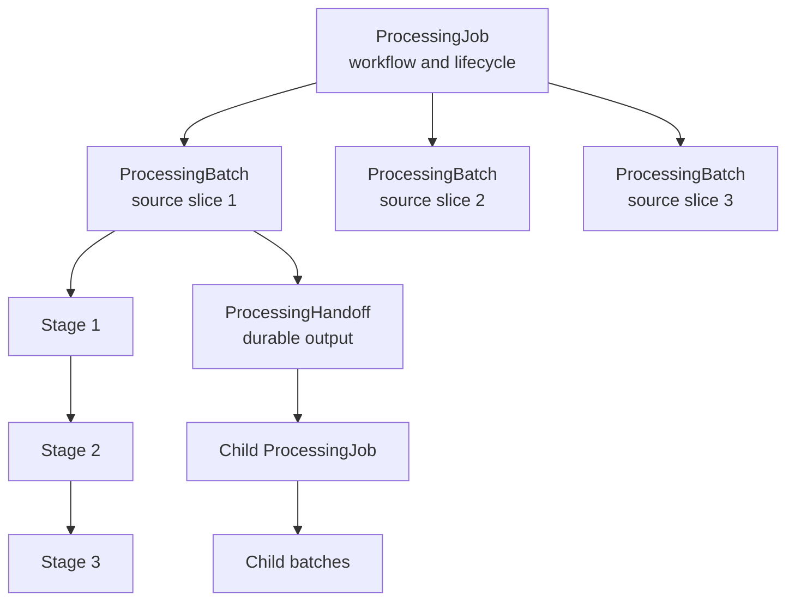
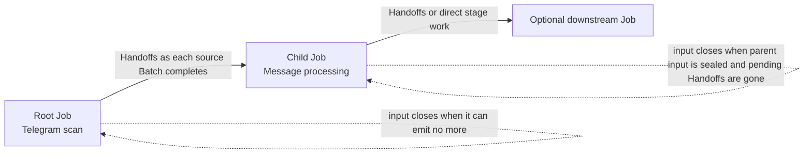
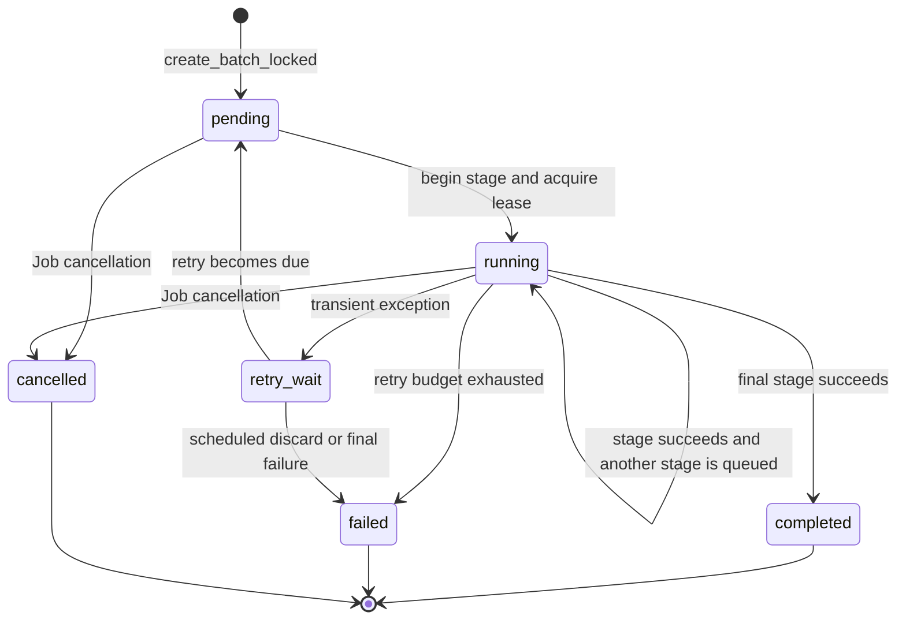
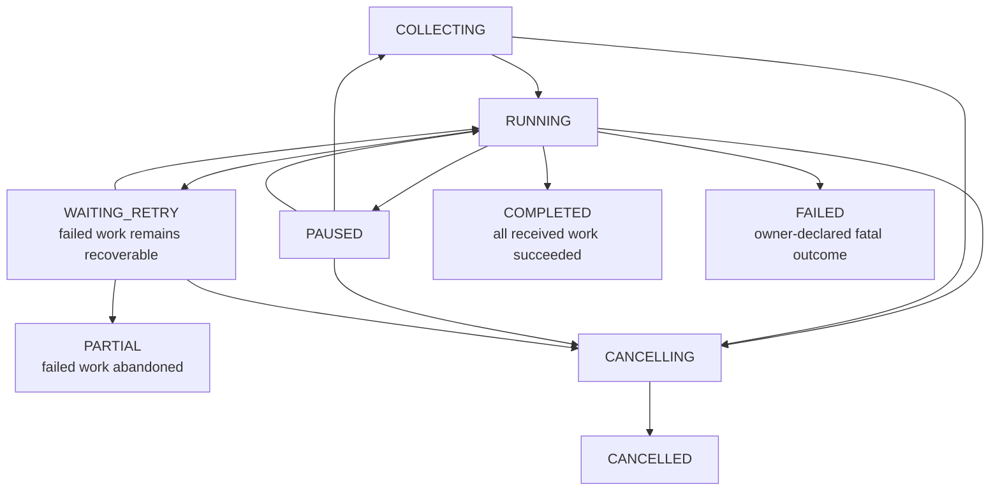
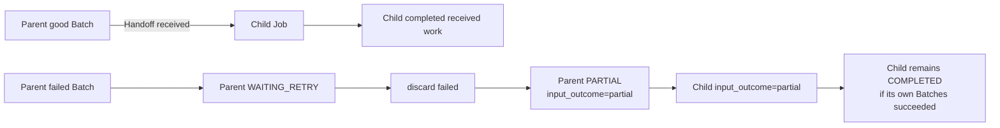
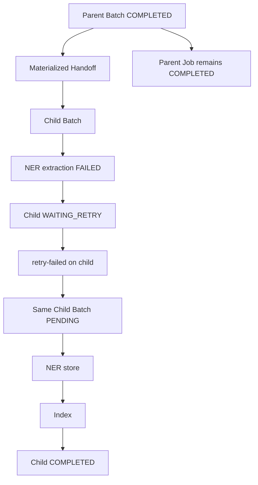
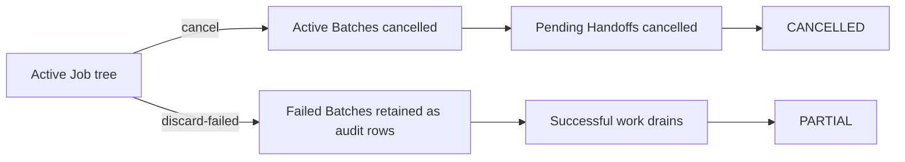

# Processing model

## Overview

Atenea represents long-running work as durable database records rather than
as an unobserved chain of Celery messages. PostgreSQL is the authoritative
record of what has been created, what is running, what has completed and what
can be retried. Celery and Redis provide delivery and execution; they do not
hold the only copy of the processing state.

The model has three layers:



* A **Job** is the durable execution envelope. It defines the owner, mode,
  ordered workflow, source boundary, lifecycle and aggregate counters.
* A **Batch** is an immutable slice of source identifiers moving through that
  Job's workflow. A Batch is the unit of leasing, retrying and stage progress.
* A **Handoff** is a durable edge between a source Batch and a target Job. It
  stores the output identifiers until the target Job materialises them into
  its own Batches.

This distinction matters. A multi-stage workflow is not a collection of
independent Jobs: one Batch moves through all its stages. A parent and child
Job, on the other hand, have separate lifecycles and communicate through
Handoffs.

## Shared status enums

Processing states are defined by category in reusable `enums.py` modules:

| Module | Categories |
| --- | --- |
| `app_scheduler/enums.py` | `JobMode`, `JobStatus`, `InputOutcome`, `BatchStatus`, `HandoffStatus`, `ItemProgressState` and `TaskOutcome`. |
| `app_telegram/enums.py` | `MediaStatus`, `ExternalUrlStatus`, `MediaProgressStatus`, `TelegramTaskOutcome` and terminal checkpoint rules. |
| `app_entity/enums.py` | `NERStatus` and `NERTaskOutcome`. |
| `app_metadata/enums.py` | `EmbeddingSyncStatus`, `MetadataProcessingStatus` and `MetadataTaskOutcome`. |
| `app_dashboard/enums.py` | `StageDisplayState`, derived for graph and detail presentation. |

Django model choices use `TextChoices`. Checkpoint and task response values use
`StrEnum`. Import the enum for the concept being read or written, compare
stored strings with its members, and use `.value` when writing JSON or Redis:

```python
from app_scheduler.enums import ItemProgressState, JobStatus

if batch.job.status == JobStatus.PAUSED:
    ...

progress[parent_id]["state"] = ItemProgressState.COMPLETED.value
```

The strings stored in PostgreSQL/Redis and returned by the API remain the same.
Model aliases such as `ProcessingJob.PAUSED`, `ProcessingBatch.PENDING` and
`NERState.COMPLETED` remain available as plain strings backed by these enums.
Field choice values, labels and ordering retain their existing definitions.

Job, Batch, item progress and task outcome describe different records. For
example, a paused task can return `TaskOutcome.PAUSED` while releasing its
Batch to `BatchStatus.PENDING`. Credential waits return
`TaskOutcome.WAITING_RETRY` while the Batch is stored as `BatchStatus.RETRY_WAIT`.
The scheduler's active, terminal and retryable status groups are defined
alongside their enums, including the active Job uniqueness constraint.

The owner defines which input outcomes are terminal within its Batch.
`SCAN_ROOM_TERMINAL_STATES` contains completed and deferred rooms;
`SCAN_COMMENT_PARENT_TERMINAL_STATES` contains completed and skipped parents.
Comments persist only `ItemProgressState` values in checkpoints; an early
pause is a task control outcome and does not overwrite parent progress.

## ProcessingJob

`ProcessingJob` is intentionally domain-agnostic. Its `processor` and
`workflow` values are opaque keys supplied by the owning application. The
scheduler validates their shape and uses the workflow to advance a Batch, but
does not know what a Telegram room, message, entity or vector means.

### Main fields

| Field | Meaning |
| --- | --- |
| `processor` | Stable owner key, such as `telegram.scan.rooms` or `entity.ner`. |
| `mode` | `live` for a finite live collection or `backfill` for cursor-driven source discovery. |
| `workflow` | Ordered, non-empty list of unique stage keys. Every Batch in the Job follows this order. |
| `parent_job` | Optional parent in a composed pipeline. The relationship is a Job tree, not a Celery chain. |
| `filters` | Normalised processor-owned source selection. The scheduler stores it for inspection and fingerprinting. |
| `source_snapshot_at` | Upper boundary used by backfills and other source readers that require a reproducible view. |
| `source_cursor` | Processor-owned cursor for incremental source discovery. |
| `source_exhausted` | Indicates that a cursor-driven source has no more input for this run. |
| `input_closed_at` | The Job will emit no more direct input. Existing Batches and downstream work may still be draining. |
| `input_outcome` | `complete` if all expected input was supplied, or `partial` if some upstream input was deliberately abandoned. |
| `lifecycle_policy` | Snapshot of the schedule policy that created the Job. Manual Jobs leave this object empty. |
| `retry_deadline_at` | Concrete deadline used by the reconciler for scheduled automatic finalisation. |
| `fingerprint` | Stable identity of the processor, mode, workflow and filters. It does not include the schedule policy. |
| `batch_size` | Target number of source identifiers per Batch. |
| `max_inflight_batches` | Capacity limit for dispatched, running or retrying Batches in this Job. |
| counters | Cached totals for direct Batches and, on a root Job, descendant work. |

The active uniqueness constraint is `(processor, fingerprint)`. It applies
only while a Job is active, so a completed or partial scheduled run does not
block the next occurrence. A running equivalent is normally reused; the
optional replacement policy is described in [Scheduling](scheduling.md).

### Job topology

A Job can be a root or a node in a larger processing tree. The root owns the
source boundary. A child may begin processing the input it has already
received while the parent is still producing more Handoffs. A child is not
required to wait for the parent Job to become terminal.



The parent closes the child's input only when it can no longer emit more
Handoffs. This is separate from whether the child has completed the Batches it
has already received.

## ProcessingBatch

Channel comment collection uses explicit parent-message batches with cursor
discovery and independent parent transactions. See
[Scanning channel comments](pipelines/scan-comments.md) for date semantics, configuration,
concurrency, recovery and the input-version deployment procedure.

`ProcessingBatch` is the unit of work sent to a domain task. It contains an
immutable list of source identifiers and the metadata needed to interpret
them:

* `item_ids` and `item_content_type` identify the source records;
* `ordinal` gives a stable order within the Job;
* `resource_key` serialises work that must share a credential or other
  resource, while leaving unrelated Jobs independent;
* `current_stage` and `completed_stages` describe the workflow position;
* `stage_attempts` records attempts per stage;
* `processor_metadata` and `processor_version` provide an audit trail without
  making the scheduler interpret domain data;
* `result_summary` stores the Pydantic-validated, versioned stage results.
  Version 1 carries `schema_version: 1`. Each stage is keyed by its workflow
  key and records measured inputs, processed counts, outputs, and known skip
  or failure reasons. A `null` count means unknown; zero means it was measured
  as zero;
* `lease_token`, `lease_until`, `queued_at` and `run_after` protect execution
  against duplicate or late Celery deliveries.

A task receives a Batch UUID, not the complete payload in Redis. It loads the
Batch and its source records from PostgreSQL, acquires a short database lock
to claim the stage, performs external work outside that transaction, then
reacquires the Batch to commit the result.

### Batch stage progression

For a workflow such as
`[entity.ner.extract, entity.ner.store, telegram.index.messages.write]`,
each Batch follows this path:



When a non-final stage succeeds, the Batch is returned to `pending`, its
`current_stage` is advanced and the next stage is published after the
transaction commits. When the final stage succeeds, the Batch becomes
`completed` and the Job lifecycle is refreshed.

The stage task must verify its lease token before committing. A late task that
no longer owns the Batch cannot move it backwards.

### Database locks and deadlocks

Operations changing a Job and a Batch use `lock_batch_and_job`: acquire the
Job first, then its Batch, with `FOR NO KEY UPDATE`. Writers remain mutually
exclusive while upstream transactions can commit foreign keys to those rows.
Tree controls lock Jobs in creation order, with UUID as the tie breaker;
bulk retries include intermediate descendants before acquiring deeper nodes.

A Scan checkpoint updates only its Batch and refreshes Job counters after
commit. Messages, Handoffs, room offsets and checkpoint progress remain in
the same transaction. Handoff materialisation locks only its own rows, not
the shared ContentType joined for reading.

`retry_on_deadlock` retries SQLSTATE `40P01` at an owned transaction boundary,
with three attempts and a short randomized backoff after rollback. Nested
operations leave recovery to the outer transaction owner. Commit callbacks
record success before executing application callbacks, so an error after
commit cannot replay confirmed data. Coordination callbacks retry their own
transactions. NER persistence retries reuse the extraction response.

Dispatch queues no work when capacity is zero and locks candidates as needed.
Lease recovery works per Job and routes due retries through the same capacity
check instead of publishing additional Batches directly.

## ProcessingHandoff

`ProcessingHandoff` is the durable output of one source Batch and the input
boundary of another Job. It contains:

| Field | Meaning |
| --- | --- |
| `source_batch` | Batch that produced the output. |
| `target_job` | Job that will process the output. |
| `item_content_type` | Type of the objects in the handoff. |
| `item_ids` and `item_count` | Output identifiers awaiting materialisation. |
| `status` | `pending`, `materialized` or `cancelled`. |
| `target_batch` | The Batch created from this Handoff, once materialised. |
| timestamps | Creation and materialisation audit data. |

Handoffs are initially chunked using the target Job's `batch_size`. Creating a
Handoff does not immediately create a target Batch. `dispatch_handoffs` groups
pending identifiers only when they came from the same source Batch and have the
same content type. It dispatches full target Batches as capacity becomes
available. Any remainder waits until that specific source Batch completes or
fails, then it can be dispatched as a partial Batch. There is no age-based
timeout, and identifiers from different source Batches are never combined. A
Handoff is split into fragments if its identifiers cross a target Batch
boundary; each fragment retains the original source Batch link. Cancelling a
Job tree still cancels its pending Handoffs.

This reduces underfilled downstream Batches without making the child backlog
unbounded: target Job capacity still controls how many Batches are queued or
running at once.

The source operation and Handoff creation are committed together. If a worker
dies after the source output is committed but before publication, the pending
Handoff remains visible and the reconciler or a post-commit nudge can publish
its materialisation task again.

Once a Handoff is materialised, the target Batch becomes the canonical copy of
the item membership. The Handoff retains its source and target links, status,
count and timestamps; the implementation may clear the duplicate `item_ids`
array to avoid retaining a second large JSON payload.

### Incremental handoff

The parent does not wait for all source Batches before handing off output:

```mermaid
sequenceDiagram
    participant P as Parent Job
    participant PB as Parent Batch 1
    participant H as Handoff store
    participant C as Child Job
    participant CB as Child Batch

    P->>PB: dispatch source slice
    PB->>H: commit message identifiers
    H-->>C: enqueue handoff dispatcher
    Note over H,C: Keep a partial group pending while PB is active.
    C->>CB: materialise full groups within child capacity
    CB->>CB: run NER, store and index stages
    PB-->>P: source Batch completed
    P->>C: flush PB's remaining partial group
    Note over P,C: Other parent Batches may still be running; their handoffs stay separate.
    P->>C: close input only after no more Handoffs can be produced
```

## Job lifecycle

### Job statuses

| Status | Meaning | Can new work be dispatched? | Terminal? |
| --- | --- | --- | --- |
| `COLLECTING` | The Job is accepting or discovering input. This is common for a live Job or an open child input boundary. | Yes | No |
| `RUNNING` | Input may be closed or still arriving, and runnable Batches may execute. | Yes | No |
| `PAUSED` | An operator paused the Job tree. Pending deliveries are made harmless and are republished on resume. | No | No |
| `CANCELLING` | Transitional state while active Batches and pending Handoffs are being cancelled. | No | No |
| `CANCELLED` | The operator cancelled the Job tree. Active Batches and pending Handoffs were cut off. | No | Yes |
| `COMPLETED` | All input received by this Job was processed successfully. Descendants have independent statuses. A child can be `COMPLETED` with `input_outcome=partial` when its parent abandoned input it never received. | No | Yes |
| `WAITING_RETRY` | No ordinary work is currently running, but at least one of this Job's own failed Batches remains recoverable. | No | No |
| `PARTIAL` | This Job's failed work was deliberately abandoned. Successful work is retained; downstream failures do not change a completed parent to partial. | No | Yes |
| `FAILED` | A terminal owner-declared Job failure. Ordinary failed Batches are normally represented by `WAITING_RETRY` first. | No | Yes |

### Status assigned when resuming a Job

When a paused Job is resumed, the scheduler chooses its active status from
two facts: whether it can still receive input, and whether it is a backfill
whose source dispatcher needs the Job to be RUNNING.

    job.status = (
        ProcessingJob.RUNNING
        if job.input_closed_at or job.mode == ProcessingJob.BACKFILL
        else ProcessingJob.COLLECTING
    )

| Input boundary | Mode | Status after resume | Practical meaning |
| --- | --- | --- | --- |
| Closed | LIVE or BACKFILL | RUNNING | No more direct input will be added; existing work can continue. |
| Open | BACKFILL | RUNNING | A cursor-based source can keep finding and dispatching older records. |
| Open | LIVE | COLLECTING | The Job may still receive live input, commonly through Handoffs from a parent. |

This is a resume rule, not a rule that says every LIVE Job is COLLECTING.
For example, /api/v1/tg/room/scan creates a LIVE root Job from a fixed list
of rooms, closes that root input after creating its room Batches, and runs it
as RUNNING. Its message-processing child is LIVE with open input, so it starts
as COLLECTING while the scan can still hand it messages. Once the scan can no
longer produce Handoffs, the child input is closed and it runs down its
remaining Batches.

For /api/v1/tg/msg/scan, the comments root is BACKFILL and discovers old
parent messages through a cursor, so it runs as RUNNING while it can still
find source pages. Its LIVE child remains COLLECTING until the root has no
more comments to hand off. The request examples and pipeline topology are in
the [pipeline catalogue](pipelines/pipelines.md).

COLLECTING and RUNNING are both active states, but the distinction can affect
dispatch. A live child can accept Handoffs while collecting; cursor-driven
backfill dispatchers commonly require RUNNING before fetching another page.
The status describes the Job's input lifecycle and can also gate source work.
It is not only a display label.

`WAITING_RETRY` is deliberately not terminal. It prevents the scheduler from
silently treating failed Batches as successful and gives the operator or the
schedule policy a chance to retry or abandon them.

The lifecycle refresh follows these rules:

1. A failed Batch is terminal for Batch accounting, but remains recoverable at
   Job level.
2. If the Job has failed Batches and they have not been abandoned, the Job is
   `WAITING_RETRY` once other non-terminal work has drained.
3. A successful parent becomes `COMPLETED` when its own input is closed and
   processed. Its children keep their own lifecycle, capacity and retries.
4. `PARTIAL` means that some expected work is known not to have been processed;
   it is not an alias for an ordinary transient failure.

### State transitions



The diagram is a conceptual view. A child can remain `COLLECTING` or
`RUNNING` after its parent has entered `WAITING_RETRY`, because it may already
have received valid Handoffs. Conversely, a child may become `COMPLETED` while
the parent remains `WAITING_RETRY` if all input it received was processed and
the missing input belongs to the failed parent Batch.

## Failure and recovery scenarios

### 1. Transient failure in a parent Batch

```mermaid
sequenceDiagram
    participant S as Scan Job
    participant B1 as Scan Batch 1
    participant B2 as Scan Batch 2
    participant N as Message Job

    S->>B1: run scan
    B1->>N: Handoff messages from room group 1
    N-->>B1: downstream processing succeeds
    S->>B2: run scan
    B2-->>S: retries exhausted; Batch becomes FAILED
    S->>S: WAITING_RETRY
    Note over N: Existing downstream work is preserved.
    S->>B2: retry-failed
    B2->>N: Handoff recovered messages
    N->>N: process only new/recovered Batches
    S->>S: COMPLETED after its own scan Batches finish
```

Retrying the parent does not replay successful Batches. It reopens the
descendant input boundary where necessary so the recovered Handoffs can enter
the existing child Jobs.

### 2. Parent failure is discarded

This is the explicit partial-processing path, used manually or by an enabled
scheduled lifecycle policy.



Discarding is not deletion. Failed Batches remain `FAILED` with
`failures_abandoned_at` and an explanatory error so that the audit trail shows
what was omitted. Their identifiers cannot be retried through
`retry-failed` after abandonment.

### 3. The child has its own failure

A child failure is independent of a completed parent Batch:



The parent does not need to repeat its completed source stage. A retry on the
child operates on the child Job's failed Batches and continues from the
failed stage's beginning.

The scheduled scan may already be `COMPLETED` or `PARTIAL`; neither outcome
abandons the child's NER/index work. The next scan can start independently.
The dashboard offers **Retry pending processing** on a parent and **Retry all
pending message processing** in the Job list after a shared dependency outage.

### 4. Cancellation

`cancel` is an operator command, not a retry policy. It walks the Job tree,
marks active Batches as `CANCELLED`, cancels pending Handoffs and settles the
active Jobs as `CANCELLED`. Already completed parents retain their own outcome.
It is intentionally different from `discard-failed`:



There is no general restart operation for a cancelled tree. If the work is
still required, create a new Job or launch the corresponding schedule again.

## Retry, pause and operator actions

The operational API is exposed under `/api/v1/scheduler/jobs`:

| Operation | Endpoint | Effect |
| --- | --- | --- |
| Inspect Job | `GET /api/v1/scheduler/jobs/{id}` | Returns lifecycle, counters, workflow, policy and child identifiers. |
| Inspect Batches | `GET /api/v1/scheduler/jobs/{id}/batches` | Returns stage, lease, attempt, result and error information. |
| Pause | `POST /api/v1/scheduler/jobs/{id}/pause` | Pauses the whole tree and stops new dispatch. |
| Resume | `POST /api/v1/scheduler/jobs/{id}/resume` | Reopens a paused tree and republishes eligible work. |
| Cancel | `POST /api/v1/scheduler/jobs/{id}/cancel` | Cancels the whole active tree, including pending Handoffs. |
| Retry failed | `POST /api/v1/scheduler/jobs/{id}/retry-failed` | Resets only that Job's failed Batches to `PENDING`; successful Batches remain complete. |
| Retry pending processing | `POST /api/v1/scheduler/jobs/{id}/retry-pending` | Retries recoverable failed Batches in that Job and its descendants. Explicitly abandoned/cancelled work is preserved. |
| Discard failed | `POST /api/v1/scheduler/jobs/{id}/discard-failed` | Abandons failed work, closes input as partial and lets successful downstream work drain. |

`retry-failed` is a Job-level operation. If both a parent and child have
independent failures, they may be retried independently. Retrying the parent
does not re-run a child Batch that is already complete.

## Recovery and reconciliation

`app_scheduler.tasks.reconcile_processing_jobs` runs from Celery Beat at the
configured reconciliation interval. It performs three generic recovery jobs:

1. finalises due scheduled root Jobs according to their lifecycle policy;
2. recovers expired Batch leases, either returning the Batch to `PENDING` or
   marking it failed when `recover_on_lease_expiry` is false;
3. republishes retrying Batches whose `run_after` is due and nudges active
   source dispatchers and Jobs with available capacity.

The reconciler is deliberately safe to run repeatedly. Database locks,
lease tokens and terminal-state checks make late or duplicate deliveries
harmless.
