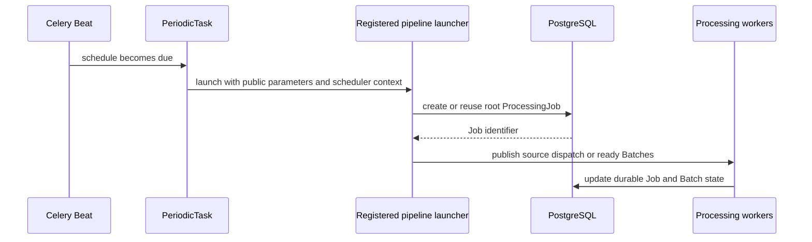
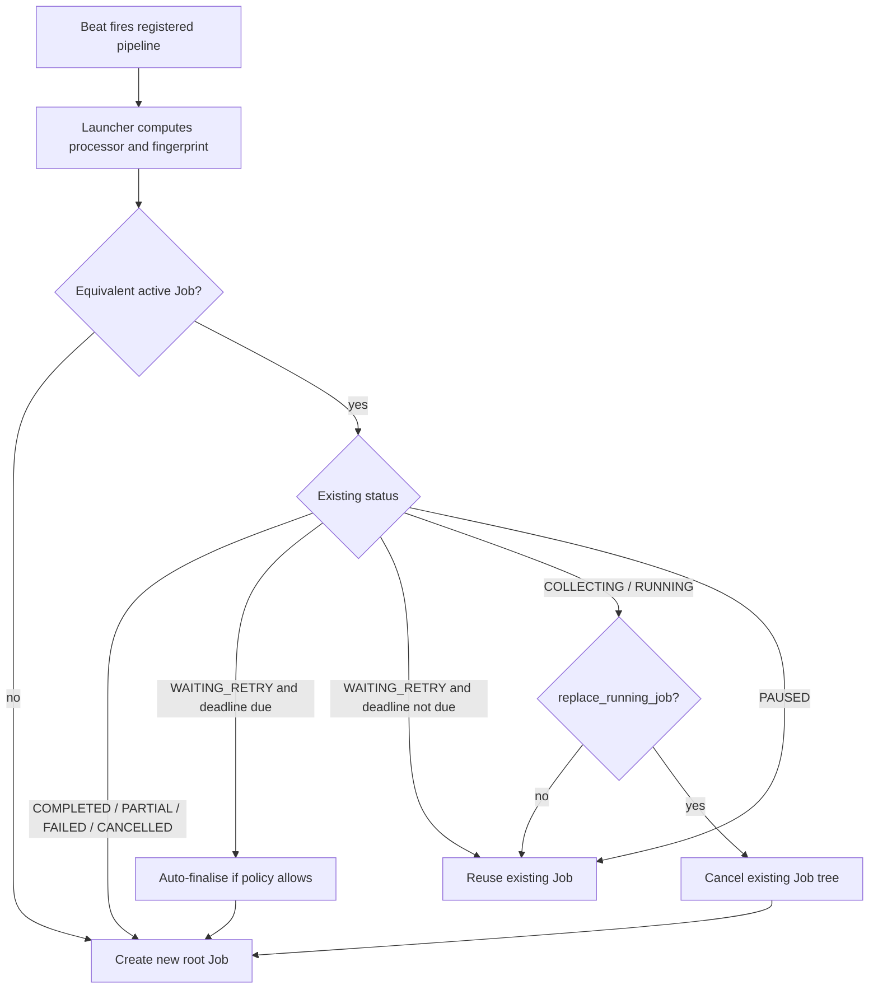

# Scheduling and lifecycle policies

## What a schedule does

A schedule does not contain a Job's work. It contains a rule for launching an
application-owned pipeline. When the rule fires, Celery Beat invokes the
registered launcher, the launcher creates or reuses a durable `ProcessingJob`,
and the normal Job and Batch protocol takes over.



The public scheduler only exposes pipeline launchers registered in
[`app_scheduler.registry`](../app_scheduler/registry.py). It
does not accept arbitrary Celery task names, internal scheduler tasks or
unvalidated task arguments.

## Schedule types

Every trigger has exactly one schedule type.

| Type | Use | Recurring? | Main fields |
| --- | --- | --- | --- |
| Interval | Run every fixed number of seconds, minutes, hours or days. | Yes | `every`, `period` |
| Crontab | Run at calendar times, with an explicit timezone. | Yes | `minute`, `hour`, `day_of_week`, `day_of_month`, `month_of_year`, `timezone` |
| Clocked | Run once at a particular date and time. | No | `clocked_time`, with `one_off=true` |

The trigger serializer rejects multiple schedule types. A clocked trigger must
be marked `one_off=true`; it has no following recurring handoff window.

Other trigger fields are:

| Field | Meaning |
| --- | --- |
| `name` | Unique operator-facing name. |
| `pipeline` | Public key from the scheduling registry. It cannot be changed on an existing trigger. |
| `description` | Optional operational description. |
| `parameters` | Pipeline-specific filters and options, validated by that pipeline's serializer. |
| `enabled` | Whether django-celery-beat may fire the trigger. |
| `one_off` | Whether the trigger should disable itself after one execution. Required for clocked schedules. |
| `start_time` | Earliest time at which Beat may run the trigger. |
| `expires` / `expire_seconds` | End-of-life limits supported by django-celery-beat. |

## Creating a trigger

Triggers are managed through the admin API at
`/api/v1/scheduler/triggers`. The API is staff-only.

### Four-hour room scan

```http
POST /api/v1/scheduler/triggers
Content-Type: application/json
```

```json
{
  "name": "telegram-room-scan-every-four-hours",
  "description": "Scan eligible rooms and process newly collected messages.",
  "pipeline": "telegram.scan.rooms",
  "parameters": {
    "room": [],
    "tags": ["monitored"],
    "tag_match": "any",
    "lang": ["en", "es"],
    "max_msgs": 2500
  },
  "interval": {
    "every": 4,
    "period": "hours"
  },
  "enabled": true,
  "auto_finalize_failed": true,
  "replace_running_job": false,
  "retry_grace_seconds": 300
}
```

The public `parameters` object contains only pipeline arguments. The scheduler
stores its internal context separately in django-celery-beat's task kwargs
under the reserved `scheduler_context` key. That context is passed through the
launcher and is removed again when the trigger is presented through the API.

### Crontab

```json
{
  "name": "nightly-message-index",
  "pipeline": "telegram.index.messages",
  "parameters": {
    "tags": ["monitored"],
    "lang": ["en"]
  },
  "crontab": {
    "minute": "15",
    "hour": "2",
    "day_of_week": "*",
    "day_of_month": "*",
    "month_of_year": "*",
    "timezone": "Europe/Madrid"
  },
  "enabled": true
}
```

### One-off clocked execution

```json
{
  "name": "one-off-ner-backfill",
  "pipeline": "entity.ner.backfill",
  "parameters": {
    "tags": ["research-set"],
    "reindex": true
  },
  "clocked": {
    "clocked_time": "2026-10-01T09:00:00+02:00"
  },
  "one_off": true,
  "enabled": true
}
```

## Lifecycle policy

The lifecycle options are selected when a trigger is created or updated. They
are copied into the root Job when Beat launches it, so changing a trigger does
not change the rules of a Job already in progress.

| Option | Default | Behaviour |
| --- | ---: | --- |
| `auto_finalize_failed` | `true` | When a scheduled root Job has exhausted its task retries and reaches a due `WAITING_RETRY` state, abandon only its own failed work and finish that Job as `PARTIAL`. Child processing remains independently retryable. |
| `replace_running_job` | `false` | When enabled, cancel an equivalent `COLLECTING` or `RUNNING` Job from the same trigger and start a new one. This is an advanced and potentially destructive option. |
| `retry_grace_seconds` | `300` | Requested safety margin before the next recurring schedule fire. It gives automatic retries time to run before the old Job is closed. |

### The retry grace period

The value is a requested number of seconds, not an unrestricted promise that
the Job will always be finalised exactly that many seconds before the next
fire. It must be a positive integer. The effective margin is capped by the
remaining time to the next scheduled fire:

```text
effective_grace = min(
    retry_grace_seconds,
    max(floor(seconds_until_next_run / 4), 1)
)
retry_deadline = next_run - effective_grace
```

The cap leaves at least three quarters of the remaining interval for the
ordinary retry cycle. For a four-hour schedule, the default five-minute margin
is normally used. For a one-hour schedule it is still five minutes. For a
one-minute schedule, a requested five-minute margin is capped at fifteen
seconds.

The calculation uses the next real Beat slot. For an interval trigger it uses
`PeriodicTask.last_run_at` and the interval; for a crontab it uses the
calendar and timezone. It does not simply add the interval to the moment a
failure was observed. This prevents a missed Beat slot from moving the next
handoff indefinitely into the future.

The setting is validated in both the REST serializer and the dashboard form
as a positive integer. The cadence-relative cap is applied centrally by the
backend because only the backend has the authoritative Beat timestamp and
calendar calculation.

### Which Jobs are eligible for automatic finalisation?

Only scheduled root Jobs with all of the following properties are eligible:

* `lifecycle_policy.scheduled` is true;
* `auto_finalize_failed` is true;
* the root Job is `WAITING_RETRY`;
* `retry_deadline_at` has passed.

A manually created Job has an empty lifecycle policy and no schedule deadline.
It remains `WAITING_RETRY` after its task retry budget is exhausted until an
operator retries or discards its failed work. A one-off clocked trigger also
has no recurring successor deadline.

Automatic finalisation is not cancellation. It preserves successful Batches,
materialised Handoffs and downstream work that is already running. It converts
retrying Batches that have reached the deadline into auditable failed Batches,
marks the scheduled root's failed work as abandoned and allows that Job to settle as `PARTIAL`.
The failed rows are retained; their identifiers are not silently deleted.

If `auto_finalize_failed=false`, the scheduled Job remains
`WAITING_RETRY`. Later occurrences continue to fire, but the active-fingerprint
check reuses that existing Job instead of creating duplicates. An operator must
then use `retry-failed` or `discard-failed`, or change the operational policy
and handle the existing run explicitly.

If a child processed every Handoff it received successfully, it may finish as
`COMPLETED` with `input_outcome=partial`. A child with its own failed Batches
remains `WAITING_RETRY`; the parent's schedule deadline never abandons them.
Once the scan's own work has finished or been discarded, its active fingerprint
is released even while NER or indexing is pending. Subsequent scheduled scans
can therefore collect new messages during a downstream outage.

The parent's `status` describes acquisition, not completion of the whole Job
tree. Inspect child statuses or the dashboard's downstream processing notice
to determine whether enrichment is finished. Pause, resume and cancellation
still apply to active descendants when invoked from a completed parent.

## What happens when the next schedule fires?

An active fingerprint prevents duplicate work. The schedule still fires, but
the launcher either reuses the existing Job or performs the configured
handoff action before creating a new one.



The active uniqueness constraint is checked in the database as well as in the
launcher preflight. Concurrent Beat deliveries therefore cannot create two
active equivalent root Jobs.

### Example: a four-hour scan that overlaps the next occurrence

Suppose the schedule fires at 10:00 and creates Job A.

```mermaid
sequenceDiagram
    participant Beat as Celery Beat
    participant Scheduler as Job launcher
    participant DB as ProcessingJob table

    Note over Beat,DB: 10:00
    Beat->>Scheduler: fire occurrence 1
    Scheduler->>DB: create Job A (RUNNING)

    Note over Beat,DB: 14:00
    Beat->>Scheduler: fire occurrence 2
    Scheduler->>DB: find active equivalent A
    DB-->>Scheduler: reuse A; no Job B row is created

    Note over Beat,DB: 16:00
    DB->>DB: A completes or becomes PARTIAL

    Note over Beat,DB: 18:00
    Beat->>Scheduler: fire occurrence 3
    Scheduler->>DB: no active equivalent remains
    DB-->>Scheduler: create the next Job
```

The 14:00 occurrence is not lost in the sense of a scheduler failure; it is a
deliberate deduplication decision. If A is still active at 18:00, that
occurrence is also reused. The first successor is created on the first future
Beat occurrence at which A is no longer active.

### Example: failed Job before the next occurrence

```mermaid
sequenceDiagram
    participant J as Scheduled Job A
    participant R as Reconciler
    participant B as Beat
    participant N as Next launcher

    J->>J: task retries are exhausted
    J->>J: WAITING_RETRY; retry_deadline_at is set
    R->>J: deadline reached before next scheduled fire
    R->>J: abandon failed/retry-wait Batches
    J->>J: PARTIAL; successful work retained
    B->>N: next scheduled fire
    N->>N: active equivalent no longer blocks creation
    N->>N: create successor Job
```

If the reconciler has not run between the deadline and the next Beat fire,
the launcher performs the same due-finalisation preflight before applying the
active-fingerprint lookup. This protects the schedule from a single missed
reconciliation tick.

## The running-job replacement option

The safe default is:

```json
{
  "replace_running_job": false
}
```

With the default, a running or collecting equivalent is reused. The scheduler
does not create a new Job record and does not cancel the running tree.

Setting `replace_running_job=true` changes that behaviour for an equivalent
Job created by the same trigger. The scheduler cancels the current Job tree
and then creates a successor. This can be useful when each scheduled run must
represent a strict snapshot, but it is dangerous when the interval is shorter
than the normal processing time:


The dashboard labels this setting as risky. It should normally remain disabled
unless the operator has verified that a run completes comfortably within the
schedule interval and that cancellation is safe for the external systems
involved.

## Updating and inspecting schedules

The trigger endpoints are:

| Operation | Endpoint | Notes |
| --- | --- | --- |
| List triggers | `GET /api/v1/scheduler/triggers` | Supports pipeline, name, description, schedule type and enabled filters. |
| Inspect trigger | `GET /api/v1/scheduler/triggers/{id}` | Returns public parameters and lifecycle options. |
| Create trigger | `POST /api/v1/scheduler/triggers` | Requires exactly one schedule type. |
| Update trigger | `PATCH /api/v1/scheduler/triggers/{id}` | Pipeline identity cannot be changed. |
| Delete trigger | `DELETE /api/v1/scheduler/triggers/{id}` | Removes the Beat trigger; it does not cancel an already-created Job. |

Deleting or disabling a trigger stops future launches. It does not retroactively
cancel a root Job that was already created. Use the Job cancellation endpoint
when an active run must stop.

The Job API is documented in [Processing model](processing-model.md). In
particular:

* use `retry-failed` to preserve successful work and retry only failed Batches;
* use `discard-failed` when missing input is acceptable and the run should be
  closed as `PARTIAL`;
* use `cancel` when the whole active tree must be stopped;
* use `pause` and `resume` for a temporary operational intervention.

## Configuration and deployment

The schedule policy is stored in the database, while worker behaviour remains
controlled by environment-backed Django settings. The most relevant settings
for scheduled pipelines are:

| Setting | Default | Purpose |
| --- | ---: | --- |
| `NER_RECONCILE_INTERVAL_SECONDS` | `60` | Frequency at which leases, due retries and scheduled lifecycle deadlines are reconciled. |
| `PROCESSING_BATCH_LEASE_SECONDS` | `1200` | Generic fallback execution lease. |
| `PROCESSING_VISIBILITY_TIMEOUT_SECONDS` | `9000` | Redis visibility timeout; keep it above the longest hard task limit. |
| `TELEGRAM_SCAN_MAX_RETRIES` | `3` | Retry count after the first scan delivery. |
| `NER_EXTRACT_MAX_RETRIES` | `3` | Retry count for NER extraction. |
| `NER_STORE_MAX_RETRIES` | `10` | Retry count for NER storage. |
| `INDEX_MAX_RETRIES` | `3` | Retry count for indexing. |
| `METADATA_MAX_RETRIES` | `3` | Retry count for embeddings and sentiment tasks. |

The full list of batch sizes, worker queues, leases and time limits is in the
[environment reference](enviroments.md).

### Migration

The schedule lifecycle policy is persisted by migration
`app_scheduler.0006_processingjob_schedule_lifecycle`. Existing public Beat
triggers are backfilled with the default scheduler context. Apply migrations
before restarting Beat and workers after deploying this feature:

```bash
cd src/atenea_api
uv run python manage.py migrate
```

## Operational recommendations

* Leave `auto_finalize_failed` enabled for recurring collection schedules when
  a later run can safely revisit the missed source items.
* Keep `replace_running_job` disabled unless replacement is a conscious
  operational requirement.
* Choose a retry grace period that leaves enough time for the configured task
  retries, but remember that the backend caps it for short schedules.
* Treat `PARTIAL` as a valid, inspectable result, not as a hidden success.
  Failed Batches remain visible and the next recurring run can normally pick
  up the source items again.
* Monitor both the root Job and its descendants. A completed parent does not
  by itself prove that every child received all expected input; inspect
  `input_outcome`, descendant counters and pending Handoffs.
* Keep the reconciliation Beat task running. It is the recovery mechanism for
  expired leases, missed task publication and scheduled lifecycle deadlines.
